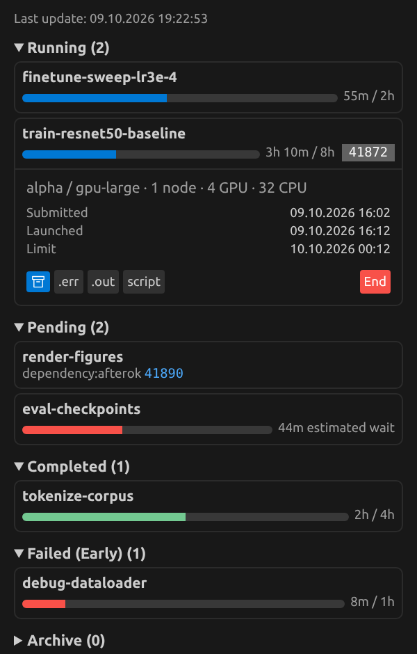
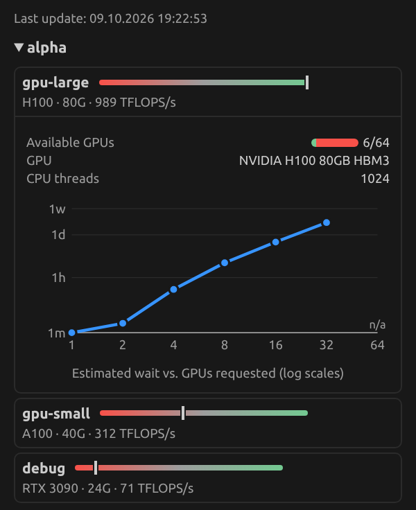
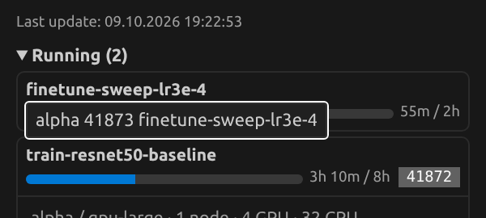
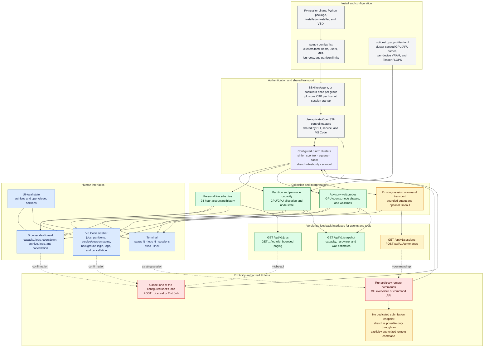

# Cluster Watcher

See your Slurm jobs and the GPU capacity of several clusters in one place: in
the VS Code sidebar, a browser tab, or the terminal. Cluster Watcher reuses one
authenticated SSH session per cluster, so you type your password and one-time
code once instead of on every query.

<p align="center">
  
  &nbsp;
  
</p>
<p align="center"><sub>The VS Code sidebar, shown with toy clusters and jobs.</sub></p>

- **All your jobs in one list.** Running, pending, and recently finished jobs
  from every cluster, with live progress, wait estimates, dependency links,
  logs, batch scripts, and a confirm-first **End** button.
- **Where to run next.** For each partition: free GPUs, GPU model, VRAM,
  TFLOPS/s, and account-aware launch estimates for 1 to 64 GPUs.
- **Log in once.** Password and OTP are requested once per session. The
  dashboard, terminal commands, VS Code, and your own scripts all share the
  same OpenSSH connection.
- **Scriptable.** Versioned JSON APIs on `127.0.0.1` for scripts and coding
  agents.
- **Safe by default.** No dependencies and read-only out of the box. It never
  submits jobs; cancelling jobs and running remote commands are separate
  opt-ins.

## Quick start

```bash
# 1. Install (Linux/macOS; see Install for Windows and other options)
curl -fsSL https://raw.githubusercontent.com/CameronBraunstein/cluster-watcher/master/install.sh | bash -s -- --add-to-path

# 2. Describe your clusters once
cluster-watcher setup

# 3. Start the service: opens the web dashboard and feeds VS Code
cluster-watcher serve --jobs-api
```

In VS Code, install the extension and run **Cluster Watcher: Start Service &
SSH Sessions** instead of step 3; see [VS Code sidebar](#vs-code-sidebar).

## Contents

- [Install](#install)
- [Configure](#configure)
- [Use it](#use-it):
  [VS Code sidebar](#vs-code-sidebar) ·
  [Web dashboard](#web-dashboard) ·
  [Terminal boards](#terminal-boards) ·
  [Shared SSH sessions](#shared-ssh-sessions)
- [Reading the numbers](#reading-the-numbers):
  [availability](#gpu-availability) ·
  [job progress](#job-progress-and-dependencies) ·
  [priority](#priority-gauges) ·
  [wait estimates](#estimated-queue-waits) ·
  [GPU catalog](#gpu-catalog-and-compute-ranking)
- [APIs for scripts and agents](#apis-for-scripts-and-agents)
- [Under the hood](#under-the-hood)
- [Development](#development)
- [License](#license)

---

## Install

### Prebuilt executable (recommended)

**Linux and macOS** need only `bash`, `curl` (or `wget`), and OpenSSH; Python
is not required. The installer downloads the executable for your OS and CPU
from the latest
[GitHub Release](https://github.com/CameronBraunstein/cluster-watcher/releases),
verifies its SHA-256 checksum, and installs `cluster-watcher` in
`~/.local/bin`:

```bash
curl -fsSL https://raw.githubusercontent.com/CameronBraunstein/cluster-watcher/master/install.sh | bash -s -- --add-to-path
```

Pin a release with `--version v0.1.0`. From a clone, `./install.sh` does the
same, and `./install.sh --from-source` builds the executable locally with
PyInstaller instead (Python 3.11+).

**Windows** 10 build 1809 or newer (ARM64 requires Windows 11):

```powershell
$installer = Join-Path $env:TEMP "cluster-watcher-install.ps1"
Invoke-WebRequest https://raw.githubusercontent.com/CameronBraunstein/cluster-watcher/master/install.ps1 -OutFile $installer
& $installer -AddToPath
cluster-watcher setup
```

> [!NOTE]
> Native Windows supports clusters that use SSH keys or `ssh-agent`. Windows'
> OpenSSH lacks the `ControlMaster` connection sharing needed to keep
> password/OTP sessions open, so use Cluster Watcher (and the VS Code
> extension) inside WSL for those clusters. The Windows OpenSSH Client
> optional feature must be installed.

**Supported platforms.** Release binaries cover Linux glibc 2.17+ and macOS
12+ on x86-64 and ARM64, Windows 10 1809+ on x86-64, and Windows 11+ on ARM64.
Alpine/musl Linux is not prebuilt; install from source there. Exact targets
are listed in [`release-platforms.json`](release-platforms.json) and attached
to each release as `PLATFORMS.json`.

### Other ways to install

| Method | Command |
| --- | --- |
| Python 3.11+ (no dependencies) | `pipx install git+https://github.com/CameronBraunstein/cluster-watcher` |
| Editable checkout for development | `python3 -m pip install --editable .` |
| VS Code extension | Install the release's `.vsix` with **Extensions: Install from VSIX…** (or from the Marketplace). It can download its own matching backend; see [VS Code sidebar](#vs-code-sidebar). |

If the shell cannot find `cluster-watcher` after a user-level Python install,
add the user scripts directory to `PATH` or activate the virtual environment.
From a checkout, `python3 cluster_watcher.py …` and `python3 -m clusterwatcher …`
also work. Python module names use underscores, while every command, package,
and standalone artifact is named `cluster-watcher`.

<details>
<summary><b>What the installers do</b> (files, PATH, managed profiles, aliases)</summary>

By default `install.sh` downloads `cluster-watcher-<os>-<architecture>` and
`SHA256SUMS` from the GitHub Release (`--version TAG`, default latest) and
refuses to install on a missing entry or checksum mismatch. It also works when
piped into `bash`, since it then needs no checkout. `CLUSTER_WATCHER_REPO`
selects another `owner/repo`, and `CLUSTER_WATCHER_RELEASE_URL` another
download base URL (including `file://` for offline mirrors). With
`--from-source` it checks for Python 3.11+ and the project files and builds in
a disposable virtual environment, so it does not install packages into your
normal Python environment.

Either way it checks for OpenSSH and writable, safe destinations, refuses to
run as root, and atomically installs a platform-qualified executable plus one
stable command shim in `~/.local/bin`:

```text
cluster-watcher-linux-x86_64
cluster-watcher
```

The `cluster-watcher` shim passes the native per-user `clusters.toml`
automatically and selects the correct platform executable, so the command
works from any directory. On first installation, a personal `clusters.toml`
beside `install.sh` is copied there with user-only permissions; without one,
the installer asks you to run `cluster-watcher setup`. Later runs preserve
that copy. The installer refuses symbolic-link destinations and unrelated
existing commands. `--force` moves conflicting command files to a timestamped
backup before replacing them; it never overwrites the installed
configuration. Reinstalling over the earlier underscore-named prototype
migrates its managed files to a recovery backup rather than deleting them.

`--add-to-path` authorizes the installer to add `~/.local/bin` to the
appropriate Bash, Zsh, or POSIX shell profile. It verifies the persistent
profile even if `PATH` already contains that directory, backs up an existing
profile, and appends a marked entry so newly opened terminals inherit the
command. Omit the option to edit your shell setup yourself. Custom
destinations are available through `--bin-dir`, `--config-dir`, and
`--state-dir`; run `./install.sh --help` for details.

Some managed systems prohibit direct edits to `.bashrc` or `.zshrc` and source
a user-owned private file instead. When the standard profile references
`.bashrc_private`, `.zshrc_private`, or `.profile_private`, the installer
writes there, using a recognizable managed block:

```bash
# >>> cluster-watcher initialize >>>
# !! Contents within this block are managed by 'cluster-watcher install.sh' !!
export PATH='/home/example/.local/bin':"$PATH"
# <<< cluster-watcher initialize <<<
```

The uninstaller removes this exact block (and the older two-line
`# Added by Cluster Watcher install.sh` format), but not a block whose
contents were changed manually.

`install.ps1` is the Windows equivalent. It verifies the same `SHA256SUMS`,
installs the architecture-qualified executable and a stable
`cluster-watcher.exe` under `%LOCALAPPDATA%\Programs\ClusterWatcher`,
preserves configuration, and changes only the current user's PATH when
`-AddToPath` is given. `-Version`, `-FromSource`, `-Force`, `-BinDir`,
`-ConfigDir`, and `-StateDir` mirror the Unix options. A private sidecar
beside the executable keeps a custom `-ConfigDir` effective from any working
directory.

Without installing, you can instead add an interactive-shell alias to a
user-owned profile, using absolute paths to a checkout:

```bash
alias cluster-watcher='/absolute/path/to/cluster-watcher/dist/cluster-watcher-linux-x86_64 --config /absolute/path/to/cluster-watcher/clusters.toml'
```

Unlike the installer's command shim, an alias is generally unavailable to
non-interactive scripts.

</details>

### Uninstall

```bash
./uninstall.sh                 # keeps your configuration
./uninstall.sh --purge-config  # also backs up and removes clusters.toml and gpu_profiles.toml
```

On Windows, run `uninstall.ps1` (add `-PurgeConfig` or `-KeepPath` as
needed). It is also attached to every release:

```powershell
$uninstaller = Join-Path $env:TEMP "cluster-watcher-uninstall.ps1"
Invoke-WebRequest https://raw.githubusercontent.com/CameronBraunstein/cluster-watcher/master/uninstall.ps1 -OutFile $uninstaller
& $uninstaller
```

<details>
<summary><b>Uninstaller details</b></summary>

The uninstaller reads the installer's private manifest and removes only the
managed shim and platform executable. Removal is recoverable: files move to a
timestamped directory under `~/.local/state/cluster-watcher/` (or the Windows
state directory). If `--add-to-path` added a marked PATH block, it removes
that exact block and backs up the profile; pass `--keep-path` to retain it.
When custom directories were used, pass the same `--bin-dir`, `--config-dir`,
and `--state-dir` values. It refuses unknown manifests, symbolic links, root
execution, and paths outside the recorded installation, stopping instead of
guessing what to delete.

</details>

---

## Configure

Run the guided setup once:

```bash
cluster-watcher setup     # alias: set-up
```

It asks for each machine's name, host, username, port, optional identity
file, whether it prompts for a password/OTP (and its shared credential group),
and log directories. It validates the result and writes the config file with
mode `0600`; an existing file is replaced only after confirmation and kept as
`clusters.toml.bak`.

To change it later, run `cluster-watcher config`. It opens the file in
`$VISUAL`, `$EDITOR`, or a native fallback (`nano`/`vim`/`vi`, or Notepad/VS
Code on Windows), validates it when the editor exits, and offers to reopen an
invalid file. You can also copy
[`clusters.example.toml`](clusters.example.toml) and edit it by hand.

**Where the file lives.** Commands read `clusters.toml` from the current
directory unless `--config PATH` is given. Installed and bundled executables
default to the per-user configuration directory: XDG on Linux,
`~/Library/Application Support/Cluster Watcher` on macOS, and
`%APPDATA%\ClusterWatcher` on Windows. `clusters.toml` and its `.bak` are
git-ignored, so personal hosts and usernames are never committed.

A minimal machine needs a unique `name`, its SSH `host`, and your `username`
(`cluster-watcher list` shows what is configured):

```toml
[[machine]]
name = "cluster-a"
host = "login.cluster-a.example.org"
username = "alice"
```

> [!IMPORTANT]
> Never put passwords in this file. Use SSH keys, an SSH agent, your normal
> `~/.ssh/config`, or the password/OTP prompts described below.

### Optional settings

| Setting | Purpose |
| --- | --- |
| `port`, `identity_file` | Standard SSH options. |
| `hidden = true` | Keep the entry but ignore the machine everywhere: no login, polling, listing, dashboard, or API. At least one machine must stay visible. |
| `default_partition_max_time_minutes`, `[machine.partition_max_time_minutes]` | Cap wait-probe runtimes (see [Estimated queue waits](#estimated-queue-waits)). |
| `job_log_roots` | Absolute remote directories that explicit log `path` requests must stay inside. |
| `interactive_auth`, `credential_group`, `control_persist` | Password + OTP logins and session lifetime (below). |
| `[dashboard] wait_threshold_minutes` | Pending-job labels and launchability-strip color thresholds in the browser and VS Code (see [Estimated queue waits](#estimated-queue-waits)). |

Wait probes use the smaller of their requested runtime and the partition
maximum. This example defaults to 24 hours and caps a `gpudev` development
partition at 15 minutes:

```toml
[[machine]]
name = "cluster-b"
host = "login.cluster-b.example.org"
username = "alice"
default_partition_max_time_minutes = 1440

[machine.partition_max_time_minutes]
gpudev = 15
```

`job_log_roots` only limits caller-supplied `path` values for the personal log
API; logs found through Slurm do not need it. Paths are canonicalized on the
cluster before checking, so `..` and symlinks cannot escape a root:

```toml
job_log_roots = ["/home/alice/jobs", "/scratch/alice"]
```

### Password + OTP clusters

For a host that requires a password plus a one-time code, enable interactive
authentication on that machine:

```toml
[[machine]]
name = "cluster-b"
host = "login.cluster-b.example.org"
username = "alice"
interactive_auth = true
control_persist = "8h"
credential_group = "site-b"
```

Machines in the same `credential_group` share a password, so `serve` asks for
it **once**, then asks for a fresh OTP for each machine right before opening
its connection. Group members must use the same `username` and set
`interactive_auth = true`. A machine without `credential_group` keeps the
normal OpenSSH terminal prompts. Connect to each host once by hand first (or
provision its host key), because host-key confirmation is intentionally not
automated.

`control_persist` (for example `30m`, `8h`, or `1h30m`) sets how long an idle
shared connection stays open. Every machine, including key-based ones, uses
OpenSSH multiplexing; key-based machines open their shared connection on the
first query.

<details>
<summary><b>How credentials are handled</b></summary>

The password lives only in process memory while its group starts. Each OTP is
held only while its machine authenticates and is cleared before the next one
is requested. Neither is written to configuration, temporary files,
command-line arguments, or environment variables. A small askpass helper
fetches the value through a user-private Unix socket, and unrecognized prompts
receive nothing. The in-memory broker shuts down and drops its references
after startup.

If a host rejects authentication (for example, because the OTP expired before
OpenSSH finished), Cluster Watcher asks for a fresh OTP and retries once.
Already-open connections stay up. A second rejection is reported and startup
continues with the next cluster.

Control sockets live in a user-private runtime directory (`$XDG_RUNTIME_DIR`,
or `/tmp`), not your home directory, which also works on home filesystems that
do not support OpenSSH's atomic socket creation. For long-lived unattended
use, prefer an institution-approved SSH key or certificate when available.

</details>

---

## Use it

Most views are fed by one background service:

```bash
cluster-watcher serve --jobs-api
```

| Flag | Effect |
| --- | --- |
| *(none)* | Capacity snapshot, web dashboard at `http://127.0.0.1:8080/`, and the snapshot API. |
| `--jobs-api` | Adds your jobs (last 24 hours), log tails, batch scripts, cancellation, and the jobs API. Required by the VS Code **My Jobs** view. |
| `--command-api` | Adds the SSH session and remote-command API. Allows arbitrary remote code execution; enable deliberately. |
| `--port N`, `--no-browser` | Change the port or skip opening a browser (useful on a headless login node). |
| `--refresh SECONDS` | Refresh interval for your jobs and the page (default 15 s). Avoid lowering it much: `sinfo` loads the Slurm controller. |
| `--jobs` | Add a job-state summary to the dashboard without the jobs API. |

### VS Code sidebar

The extension adds a Cluster Watcher icon to the Activity Bar with three views.
It is a thin client for the service above and has no SSH or Slurm code of its
own.

**Getting started.** If no service is running, the sidebar offers **Start
service & SSH sessions**, **Run setup wizard**, **Edit configuration**, and
**Settings**. The service starts as an extension-owned background process with
`serve --jobs-api`; password and OTP requests appear as masked VS Code input
boxes, without opening a terminal. Secrets travel only over the child process's
private stdin and are never placed in arguments, environment variables, logs,
or configuration. If a service is already listening at
`clusterWatcher.backendUrl` (default
`http://127.0.0.1:8080/`), the extension attaches to it instead of starting
another. On first use without a `cluster-watcher` command, it offers **Install
and Add to PATH**, **Use Only in VS Code**, or **Choose Existing Executable**.
In an unpackaged Linux or macOS development checkout without release metadata,
the first choice downloads the latest release through `install.sh` and checks
its `SHA256SUMS`; a source-build fallback is also available.

#### My Jobs

Jobs are grouped into **Running**, **Pending**, **Failed Dependency**,
**Completed**, **Failed (Early)**, **Failed (Timeout)**, **Cancelled**, and a
collapsed **Archive**. Each job is a card:

- **Collapsed:** the job name and a progress bar with run/allotted time or
  `<duration> estimated wait`. Long names end in an ellipsis; hover the
  **title** for `<cluster> <job ID> <full name>`.

  

- **Expanded:** the job-ID badge appears to the right of the progress bar
  (click it to copy), followed by cluster, partition, and resources;
  submit/launch/limit/end times; any dependencies; and actions: archive,
  **.err**, **.out**, **script**, and **End** (with confirmation) for running
  and pending jobs.

Click a dependency's job ID to jump to that card. Logs open as read-only
documents holding the newest 2,000 lines; **Load 2,000 Older Lines** in the
editor title bar pages backward. **script** shows Slurm's exact copy while the
job is queued or running; after it ends, it shows the current file named on
the `sbatch` command line, with a warning that it may have changed. Archives
are stored in VS Code's global state, and open/closed groups and cards survive
refreshes. Archiving or restoring a job keeps the viewport anchored to a nearby
unchanged job card rather than jumping to the top of **My Jobs**.

#### Cluster Status

Each cluster is a collapsible group of permanently expanded, compact partition
cards ordered by compute rank. A card shows the partition name and
[launchability strip](#estimated-queue-waits), followed by the best GPU's model,
VRAM, TFLOPS/s, CPU-thread total, and aligned **GPUs:** and **Nodes:**
availability bars whose fractions end in **Free**. Hover a launch block for its exact estimate, the GPU model for its full
name, the VRAM amount
for its label, or the thread count for its CPU-thread label. Hover **GPUs:**
for the GPU resource breakdown (idle, allocated, reserved, drained, and other
unavailable categories), or **Nodes:** for the partition's node-state
breakdown. Partition cards do not collapse and do not
repeat the launch estimates in a graph. A narrow card moves the complete
launchability strip flush left below the partition name instead of compressing
both onto one unreadable line.

The availability labels begin flush with the card's left edge and share one
compact column, so both bars start at the same position. A small gap separates
each bar from its fraction; trailing **Free** labels do not use a separate
alignment column. The bars stretch with the sidebar and give up width to longer
fractions when needed. Each card reserves the same count width for both bars,
so their right edges line up in a roomy sidebar. On a tight sidebar, a longer
fraction takes space from only its own bar. At very narrow widths, an
abbreviated fraction reveals its complete value on hover.

If a cluster's SSH session closes, its group shows **Log in again**, which
runs `cluster-watcher login <cluster>` in the background and presents any
password/OTP requests as masked VS Code input boxes.

#### Server Status

The third view shows whether the service is starting, waiting for credentials,
attached to an independently started process, or stopped. Its compact first
line puts a small start/stop toggle on the left. Both the control and text are
sized to preserve the complete local dashboard URL at the sidebar's minimum
width. Both extension-owned and attached services show only the dashboard URL,
without a redundant status label. The URL opens the dashboard through a button
styled as a link, avoiding a second `#` link-target tooltip; its single hover
text gives the service process ID and start time. The
green/on toggle says **Stop service** on hover, and the gray/off toggle says
**Start service**. The view also includes a bounded recent diagnostic tail and
every configured machine's reusable SSH-session state and approximate remaining
idle lifetime. Machine cards use compact spacing and truncate the smaller SSH
login address when necessary, so their status and login controls remain within
the minimum-width sidebar. An open card shows only **Open**; hover that label for
the approximate remaining reusable-session lifetime. A closed interactive
machine has **Log in** on its card. If it belongs to a `credential_group`, the
card also has **Log into all machines on `<group>`**; individual login uses the
new `cluster-watcher login MACHINE --only` mode. There is no separate global
login control because the machine cards provide the relevant scoped actions.
Stopping an attached service
requires confirmation and warns that other connected clients will be
disconnected. The managed process stops with the extension host; its OpenSSH
masters can remain reusable for their configured
`ControlPersist` period. Start `cluster-watcher serve` separately when the HTTP
service itself must outlive VS Code, and do not use **Stop service** from an
attached sidebar when it should remain available.

#### Refreshing, notifications, and settings

Each view heading has its own **Refresh** button, and **Cluster Watcher:
Refresh Sidebar** refreshes both. A `Last update` line under each heading
shows when data last changed. Unchanged refreshes cost almost nothing (the
service answers `304 Not Modified`), and progress bars and waits keep counting
locally in the meantime.

| Setting | Default | Effect |
| --- | --- | --- |
| `clusterWatcher.backendUrl` | `http://127.0.0.1:8080/` | Service to attach to. Never point it at an untrusted or public service. |
| `clusterWatcher.autoStart` | `false` | Start the managed background service when VS Code opens (off so masked MFA prompts never appear unexpectedly). |
| `clusterWatcher.configPath` | — | Use a configuration file other than the default. |
| `clusterWatcher.notifications` | `all` | Notify when a job completes, fails, or is cancelled (`all`, `failures`, `off`). |
| `clusterWatcher.statusBar` | `true` | Show `N running · M pending` (or **offline**) in the status bar. |
| `clusterWatcher.dateFormat` | `DD.MM.YYYY` | Date tokens `YYYY`, `YY`, `MM`, `DD`; times are 24-hour local `HH:mm`. |
| `clusterWatcher.executable` | — | Legacy fallback; choose executables with **Manage Backend Installation**. |

See [`vscode/README.md`](vscode/README.md) for every view detail.

<details>
<summary><b>Backend installation, Remote SSH, and WSL</b></summary>

Managed installation downloads the native backend for the extension host's
OS and architecture. The download is pinned to the extension's exact version,
size-bounded, and checked against a SHA-256 digest embedded in the VSIX
before it is smoke-tested and atomically installed. Unsupported architectures,
macOS/Windows versions, and Linux glibc versions are rejected before
download. Every managed or selected executable is checked with `--help`
before use; a broken choice shows a **Manage Backend** button.

**Cluster Watcher: Manage Backend Installation** switches between the managed
and an existing executable, adds or removes the managed directory from the
user PATH, repairs/updates it, or uninstalls it. **Use Only in VS Code** adds
the managed directory to new integrated terminals without changing PATH;
**Install and Add to PATH** also makes `cluster-watcher` available to system
terminals. Only the exact Unix profile block or Windows user-PATH entry
recorded in the ownership manifest is removed later. Uninstalling keeps your
configuration, and uninstalling the extension does not silently remove a
backend you exposed to normal terminals.

Managed backends live under `~/.local/share/cluster-watcher/vscode-backend`
(Linux), `~/Library/Application Support/Cluster Watcher/vscode-backend`
(macOS), or `%LOCALAPPDATA%\Programs\ClusterWatcher\vscode-backend`
(Windows). This is per extension host: local, WSL, Remote SSH, and container
hosts each choose separately. Workspace Trust is required because the
extension downloads and runs a native program and opens SSH sessions.

The extension is a workspace extension: under Remote SSH it runs on the remote
development host, together with the executable and its shared SSH sessions.
Sessions on your laptop are separate. The executable it launches uses the same
user-private OpenSSH `ControlPath` (derived from local user, remote user,
host, and port) as a separately started one, so each recognizes sessions the
other created, as long as both run on the same machine, as the same user, with
the same `clusters.toml`.

The Activity Bar icon (three server boxes under a magnifying glass) was made
for this project and is dedicated under CC0-1.0; see
[`vscode/media/LICENSE.txt`](vscode/media/LICENSE.txt).

</details>

### Web dashboard

`cluster-watcher serve` opens `http://127.0.0.1:8080/`. It shows:

- **My jobs** (with `--jobs-api`): collapsible **Running**, **Pending**,
  **Completed**, **Failed (Early)**, **Failed (Timeout)**, and **Cancelled**
  groups covering the last 24 hours. Each card shows name, ID, progress, and a
  completion/start estimate; hover the title for the full name. Expand a card
  for location, state, resources, lifecycle times, and **Archive**, **Open
  .err**, **Open .out** (a bounded 100-line tail). Sort controls order cards by
  name, location, state, progress, resources, or time. Archives live in the
  browser's local storage for this origin.
- **Cluster capacity:** nodes grouped under their partitions. Each node card
  shows GPUs as large cells above CPUs as small cells: green idle, red
  allocated, yellow unavailable. Nodes used by your running jobs are
  highlighted in blue. Every GPU partition also has an **Estimated queue wait**
  chart (see [Estimated queue waits](#estimated-queue-waits)).
- A small countdown clock beside the title shows the time until the next
  refresh, or `Refreshing…` while one is in flight.

Open/closed sections survive automatic refreshes while the page stays open.
On startup the page retries every second until the first collection
finishes.

> [!WARNING]
> The service binds to `127.0.0.1` and has no authentication or TLS. To view
> it from another machine, use an SSH tunnel
> (`ssh -L 8080:127.0.0.1:8080 user@login-node`). `--host 0.0.0.0` exposes
> cluster names, hosts, nodes, and utilization and must be protected by a
> firewall or an authenticated HTTPS proxy; `--jobs-api` and `--command-api`
> refuse to start on a non-loopback host.

### Terminal boards

```bash
cluster-watcher status            # capacity board, once
cluster-watcher status 15         # refresh every 15 s
cluster-watcher status cluster-a  # only some clusters
cluster-watcher jobs              # your jobs board
cluster-watcher jobs 15
```

`status` prints one table per cluster. With toy data it looks like this
(colors omitted):

```text
## alpha ##
PARTITION  GPU NAME          VRAM   TFLOPS/S  GPU AVAILABILITY  WAIT TIME · JOB UP TO 1 HOUR · GPU COUNT  CPU THREADS
                                                                1    2    4    8    16   32    64
──────────────────────────────────────────────────────────────────────────────────────────────────────────────
gpu-large  NVIDIA H100 80G…  80G    989       [░███████] 6/64   now  2m   25m  3h   14h  2.5d  n/a  1024
gpu-small  NVIDIA A100-SXM…  40G    312       [░░░█████] 19/48  now  now  5m   40m  6h   n/a   —    768
debug      NVIDIA GeForce …  24G    71        [░░░░░░░░] 8/8    now  now  now  1m   —    —     —    64
WAIT N/A gpu-large [64 GPU]: Requested node configuration is not available
WAIT N/A gpu-small [32 GPU]: Requested node configuration is not available
```

`jobs` lists running, pending, completed, failed, and cancelled jobs from the
last 24 hours, grouped under `### RUNNING ###`-style headings, with ID, name,
cluster, partition, resources, progress, and submit/launch/end times (local
timezone). Running bars are blue (elapsed vs. limit); pending bars are red and
advance toward Slurm's estimated start, or say why there is no estimate.

With an interval, both boards run full-screen like `top`: arrow keys, Page
Up/Down, Home, and End scroll; `q` or `Ctrl-C` exits and restores your
terminal. Redirected output stays plain (no colors or cursor codes, also when
`NO_COLOR` is set), and narrow terminals switch to a two-line layout. `status`
also accepts `--jobs` (legacy `squeue` summary), `--json`, and `--dry-run`
(one-shot only). Both commands reuse open shared sessions and only prompt for
clusters whose session is missing.

<details>
<summary><b>Terminal board details</b></summary>

Columns size themselves to their content instead of stretching across a wide
terminal. Launch time is shown for running, completed, and failed jobs; end
time for completed and failed jobs; other states show `—`. Job arrays appear
one task per row with canonical `ARRAY_JOB_ID_TASK_ID` IDs, and pending rows
keep the node, GPU, and CPU counts requested in `squeue`. Slurm times are
collected in UTC and shown in the local timezone.

Live mode uses an alternate screen, so old boards do not pile up in
scrollback, and scroll keys are consumed without echo and kept across
refreshes. This also works in integrated terminals that report `TERM=dumb`.

In live `status`, partitions are probed concurrently, each with a ten-second
budget and a ten-second per-probe limit; shapes the budget did not reach show
`?`. Successful estimates are cached for ten minutes and failures retried
after 30 seconds, while capacity refreshes at the requested interval. Failed
clusters are reported independently, so other clusters still show results.
Use `--help` on either command for interval and SSH-timeout options.

</details>

### Shared SSH sessions

`serve` keeps one authenticated OpenSSH connection open per cluster. Another
terminal on the same machine, as the same user, can use it without typing
the password or OTP again:

```bash
cluster-watcher sessions                          # which sessions are open, and for how long
cluster-watcher exec cluster-b -- nvidia-smi -L   # run one command
cluster-watcher exec --timeout 600 cluster-b -- bash -lc 'cd ~/project && python3 train.py --help'
cluster-watcher shell cluster-b                   # interactive shell
```

These commands do not need `--command-api`. `exec` relays stdout/stderr and
exits with the remote status. It has no time limit unless you give
`--timeout SECONDS` (status 124 on expiry) and keeps at most 1 MiB per output
stream. Neither `exec` nor `shell` logs in or silently reconnects: an unknown
machine or closed session fails with a clear message.

`sessions` shows each machine's estimated remaining idle lifetime
(`sessions --json` returns the same document as `/api/v1/sessions`). OpenSSH
does not expose its exact expiry, and activity from unrelated SSH clients is
invisible, so the value may be `unknown` or approximate. A session may outlive
`serve` until its `control_persist` idle period expires.

#### Log in again after a session closes

A login node can close a session (restart, network interruption, session
limit), after which refreshes fail with errors like `Permission denied
(gssapi-with-mic,password)`. Reopen it without restarting `serve`:

```bash
cluster-watcher login cluster-b   # this machine and its credential group
cluster-watcher login cluster-b --only  # only this machine
cluster-watcher login             # every interactive machine
```

Open sessions are skipped. A named machine brings the rest of its
`credential_group`, so the shared password is asked once and each machine
asks for its own OTP; `--only` suppresses that group expansion. The running
service picks up the session on its next
refresh. The service detects closed sessions itself (`ssh -O check`) and
reports `login_required: true`, so the web dashboard and VS Code offer the
login. Sessions send keepalives every 30 s (`ServerAliveInterval=30`,
`ServerAliveCountMax=4`), so idle sessions survive firewalls and broken ones
are noticed within about two minutes.

---

## Reading the numbers

### GPU availability

The **GPUs:** bar shows **schedulable idle** GPUs in green, then everything
else in red, followed by `schedulable idle / total`. Its tooltip accounts for
the GPUs behind each color as idle, allocated, reserved, drained, down, or
another applicable unavailable category. An unallocated GPU on a
drained, down, maintenance, rebooting, powered-off, reserved, failed, or
unresponsive node is deliberately **not** counted as available. Hover the bar
in a graphical view for this GPU-level breakdown; zero counts are omitted.

The **Nodes:** bar directly below it counts only fully idle, schedulable
nodes in green. Mixed nodes can contribute free GPUs to the GPU bar but remain
red in the node bar. Its fraction is `fully idle / total nodes`, and its
tooltip gives the node-state breakdown (idle, mixed, full, reserved, drained,
down, …).

GPU requests are recognized in both Slurm's `gpu:TYPE:COUNT` GRES form and the
`gres/gpu:COUNT` form. When Slurm leaves `Gres`/`GresUsed` empty, collection
falls back to `CfgTRES`/`AllocTRES`, and a generic GPU total is never added to
its model-specific breakdown. AMD MI300A APUs count as GPUs, as Slurm schedules
each as one `gres/gpu`.

### Job progress and dependencies

| Job | Progress shows |
| --- | --- |
| Running | Elapsed vs. full time limit (Slurm `%M` and `%l`, with `%L` as fallback), from the real start of the allocation. Advances locally between refreshes. Unlimited limits are shown as text. |
| Pending, with an estimate | A red bar from submission toward Slurm's expected start, labelled `<duration> estimated wait`. |
| Pending, no estimate | **no estimate available** (no empty bar), or the priority gauge when one exists. |
| Pending on a dependency | `dependency:<type> <job ID>`; click the ID to jump to its card. |
| Completed / failed | Recorded runtime vs. the time limit kept in accounting. A zero duration shows `<1m`. |

Expected starts come from `squeue --me --start` (backfill's current
projection). They are not reservations: priorities, new jobs, reservations,
or jobs ending early can move them, and clusters without backfill may not
provide one.

In an expanded card, each dependency ID is followed by a clock (waiting), a
green check (satisfied), or a red ✕ (failed); hover it for details. Slurm
usually drops satisfied IDs from its dependency field, so checks appear only
while the ID is still known. A job whose overall dependency can never be met
moves to **Failed Dependency**. Slurm's `TIMEOUT` state goes to **Failed
(Timeout)**; every other failure state goes to **Failed (Early)**.

The web dashboard rounds pending estimates into buckets (`< 5 minutes`,
`< 30 minutes`, `< 1 hour`, `< 2 hours`, then the nearest hour). Change the
boundaries with positive, strictly increasing minute values:

```toml
[dashboard]
wait_threshold_minutes = [5, 30, 60, 120]
```

Hovering a web-dashboard node card shows whether its GPUs are free now or the
earliest visible running-job end time, as a hint, not a guaranteed start.

### Priority gauges

Pending jobs get a number-free gauge when a global queue rank is available, or
when at least two of your visible pending jobs on that cluster have numeric
Slurm priorities. Hovering a bar gives the following two-line readout:

```text
Global priority <rank> / <all pending>
Your priority <rank> / <your pending>
```

Rank 1 has the highest Slurm score. Tied scores share a rank. The
global population is every pending array task visible through `squeue` on that
cluster; the user population contains only your visible pending jobs there. If
the cluster denies the queue-wide query, the first value says **unavailable**.
The bar's marker visualizes the global rank, with rank 1 at the green end. If
the global rank is unavailable, it falls back to the rank among your pending
jobs. The hover always identifies both scopes. The **Priority** text immediately
to the left of each bar has a short hover explaining that lower rank numbers
are considered sooner, although scheduling policy and resource fit can change
the start order.

A better rank usually means earlier consideration than lower-ranked,
resource-compatible jobs. It is not a guaranteed launch order, probability,
or start-time forecast: QOS and scheduling tiers, reservations, resource fit,
and backfill can all change which job starts. The gauge normally sits in the
expanded card; without a start estimate it replaces that message in the
summary.
Partitions deliberately do not show `PriorityJobFactor`, because that policy
component is not a meaningful measure of availability to the user.

The previously displayed large number was Slurm's raw `Priority` value. It is
a weighted scheduling score whose ingredients and scale are configured by each
cluster; common factors include job age, fair-share, QOS, partition, and job
size. Higher scores are generally considered first within the same scheduling
tier when a job fits the available resources. A value such as `4,884,753` has
no useful standalone meaning, cannot be compared across clusters, and changes
as the queue and its age/fair-share components evolve. Cluster Watcher therefore
shows both the cluster-wide and user-specific ranks while retaining the
scheduling caveats above. The global histogram is computed remotely and joins
the existing batched SSH refresh, so the complete queue is not transferred to
the local machine and no extra SSH login is opened.

### Estimated queue waits

Cluster Watcher asks Slurm when a hypothetical job **would** start, using
`sbatch --test-only`; nothing is submitted or run. For each GPU partition it
probes 1, 2, 4, … up to 64 GPUs. Browser partition headings and the always-open
VS Code partition cards show those shapes as labeled blocks, colored by the
estimated wait for a one-hour job (or the partition's shorter maximum runtime):
dark green below the first threshold, green below the second, yellow below the
third, orange below
the fourth, and red above it. The defaults are 5, 30, 60, and 120 minutes and
come from `dashboard.wait_threshold_minutes`. Black `×` blocks are rejected by
account/QOS policy, gray blocks are unavailable or unprobed, and striped `—`
blocks exceed the partition's total GPU capacity. Hover any block for the
exact runtime, estimated wait, or Slurm error. Successful wait tooltips end at
“estimated wait”; the terminal retains the corresponding `WAIT TIME` columns.

`now` means immediate placement, and `—` means the partition has fewer GPUs
than requested. Estimates reflect **your** account, QOS, fair-share, and the
current queue. They are Slurm's projection, not a reservation. Probes refresh
every ten minutes, independently of the normal refresh, so check
`wait_estimates_updated_at` in the API.

#### Why a wait has no estimate

| Label | `error_kind` | Meaning |
|---|---|---|
| `DENY` | `denied` | Your account may not use the partition. |
| `min` | `minimum` | Below the partition's minimum GPU request (`QOSMinGRES`); larger requests may work. |
| `limit` | `limit` | Over a QOS, association, per-node GPU, or time limit for your account. |
| `n/a` | `unavailable` | No node can run it now, for example because all are drained or powered down. |
| `ERR` | `timeout`, `error` | A real failure: Slurm did not answer within 60 seconds, or another error. |
| `?` | `budget` | Not probed: the partition's time budget ran out first. |
| `…` | — | The cluster's first round of probes has not finished yet. |

Only `ERR` is worth investigating; the others describe your account's policy
or the cluster's state. Hover a wait to see Slurm's message. The terminal
lists them under the table as `WAIT DENIED`, `WAIT MIN`, `WAIT LIMIT`,
`WAIT N/A`, or `WAIT ERROR` lines.

<details>
<summary><b>How probes are shaped and scheduled</b></summary>

Batch-mode probing matters on sites that limit every `srun` allocation to
short interactive walltimes, even in test-only mode. Shapes use 1-hour,
12-hour, and 24-hour walltimes, because backfill's expected start depends on
duration, each capped by the partition's configured maximum (duplicate capped
durations are probed once). Requests larger than one node are probed only for
the shortest walltime.

Each probe requests the fewest highest-capacity nodes that can provide the GPU
total (64 GPUs on eight-GPU nodes becomes an eight-node job), one task per
node (`--ntasks-per-node=1`; with a single task Slurm would silently shrink a
multi-node request), and 1024 MiB of host memory per GPU as an explicit
per-node `--mem` (some site filters do not accept `--mem-per-gpu`). The
memory is returned as `memory_mb`. GPUs are requested with `--gres=gpu:N`; if
a submission filter says that requested no GPUs, the probe is retried with
job-wide `--gpus=N` in the same SSH call. A "More than N gpus per node"
refusal is a policy limit and is not retried. `QOSMinGRES` failures are not
copied to larger GPU counts, since a larger request may satisfy them.

All shapes of a partition run in order in one SSH call; partitions and
clusters run concurrently. Each `sbatch --test-only` may take up to 60
seconds, and a partition starts no further probes after 240 seconds. The
first round starts with the service. Successful messages are parsed from both
stdout and stderr, and every scheduled refresh retries every probe. Slurm
start times without a UTC offset are interpreted in the service host's local
timezone.

</details>

### GPU catalog and compute ranking

GPU model, VRAM, and TFLOPS/s come from an optional personal catalog,
`gpu_profiles.toml`, beside your `clusters.toml` (for an installed command,
`~/.config/cluster-watcher/gpu_profiles.toml`). Start from
[`gpu_profiles.example.toml`](gpu_profiles.example.toml). Without it, no GPU
details are shown and partitions are ranked by GPU count. A malformed catalog
is reported at startup. `install.sh` adopts a `gpu_profiles.toml` found beside
it once, and the file is git-ignored.

Every `[[profile]]` needs a `cluster` equal to a `[[machine]].name`, because
partition and GRES labels are local to a cluster (an `a100` label never
borrows another cluster's profile). Profiles store per-GPU VRAM and dense
FP16/BF16 Tensor/Matrix throughput without sparsity. Aliases match GRES types,
partition names, and node names, so generic partitions can be identified from
node-name prefixes.

Partitions are ranked by their best single GPU: VRAM, then throughput, then
CPU threads. `*-all` partitions fully covered by specific partitions are
listed last as aggregates; do not add their totals to the others. In the web
dashboard, node cards inside a partition are ordered by idle GPUs, then idle
CPUs.

---

## APIs for scripts and agents

All endpoints are served by `cluster-watcher serve` on `127.0.0.1:8080` and
return JSON.

| Endpoint | Needs | Purpose |
| --- | --- | --- |
| `GET /api/v1/service` | — | Local service process ID and start time. |
| `GET /api/v1/snapshot` | — | Capacity, hardware, and wait estimates for every cluster. |
| `GET /api/v1/jobs` | `--jobs-api` | Your active and recent jobs. |
| `GET /api/v1/jobs/{cluster}/{job_id}/log` | `--jobs-api` | Bounded, pageable log tail. |
| `GET /api/v1/jobs/{cluster}/{job_id}/script` | `--jobs-api` | The job's batch script. |
| `POST /api/v1/jobs/{cluster}/{job_id}/cancel` | `--jobs-api` | Cancel one of your jobs. |
| `POST /api/v1/shutdown` | — | Gracefully stop the local service. Loopback JSON requests only. |
| `GET /api/v1/sessions` | `--command-api` | Open SSH sessions and their estimated lifetime. |
| `POST /api/v1/commands` | `--command-api` | Run a command over an existing session. |

[`AGENT_CAPABILITIES.md`](AGENT_CAPABILITIES.md) is a copy-ready guide for
coding agents. It separates observation from cancellation and remote
execution and covers discovery, log paging, session reuse, and scheduling
uncertainty. Paste it into another project's `AGENTS.md` to use Cluster
Watcher as that project's cluster source.

`/api/status` is the web page's internal, unversioned payload; scripts should
use the versioned endpoints. Incompatible changes get a new URL version.

### Snapshot

```bash
curl --fail --silent http://127.0.0.1:8080/api/v1/snapshot | python3 -m json.tool
```

```python
import json
from urllib.request import urlopen

with urlopen("http://127.0.0.1:8080/api/v1/snapshot") as response:
    snapshot = json.load(response)

for cluster in snapshot["clusters"]:
    for partition in cluster["partitions"]:
        print(cluster["name"], partition["name"], partition["gpus"]["schedulable_idle"])
```

It returns `200`, or `503` with `Retry-After: 1` before the first collection
finishes. Responses are `Cache-Control: no-store`. Usernames and personal job
details are excluded. Treat the snapshot as infrastructure data: it contains
cluster names, hosts, node names, capacities, and utilization.

<details>
<summary><b>Snapshot schema</b></summary>

| Top-level field | Meaning |
| --- | --- |
| `schema_version` | Contract version, currently `1.0`. |
| `generated_at` | ISO 8601 time of the underlying status collection. |
| `status_refresh_seconds` | Normal node/partition refresh interval. |
| `wait_probe_refresh_seconds` | Slower `sbatch --test-only` refresh interval. |
| `wait_threshold_minutes` | Configured launch-wait boundaries used to color browser and VS Code blocks. |
| `clusters` | All configured clusters, including unreachable ones. |

Each cluster has its `name` and `host`, `reachable`,
`resource_data_complete`, collection errors, unique cluster-wide resource
totals, `wait_estimates_updated_at`, and every known partition. `scheduling`
holds `scheduler_type`, `priority_type`, `priority_weight_partition`, and
`priority_flags` when Slurm exposes them (otherwise it is empty). `error` means
the cluster could not be queried; `resource_error` means partitions were read
but node/GPU detail failed. `login_required` is `true` when an
`interactive_auth` cluster's shared session has closed (fix it with
`cluster-watcher login NAME`).

| Partition field | Meaning |
| --- | --- |
| `name`, `rank`, `available` | Slurm name, compute rank, and whether the partition is administratively up (`null` if unreported). |
| `priority_job_factor`, `priority_tier` | Partition contribution to multifactor priority and its scheduling/preemption tier; `null` when unavailable. |
| `aggregate` | `true` when the partition reuses nodes of specific partitions; do not add its totals to theirs. |
| `reported_nodes`, `node_states` | Slurm node count and state distribution. |
| `cpus` | Total, allocated, and idle CPU threads. |
| `gpus` | Total, allocated, idle, schedulable-idle, unavailable-idle, maximum per node, and model inventory. |
| `wait_estimates` | Per shape: GPU and node counts, `memory_mb`, `walltime_seconds`, `expected_start_at`, `estimated_wait_seconds`, `error`, and `error_kind`. |
| `nodes` | Per-node state, resources, GPU types/specifications, and earliest visible release time. |

`gpus.idle` means physically unallocated; `gpus.schedulable_idle` excludes
GPUs on unusable nodes and is the safer routing signal, and
`gpus.unavailable_idle` is the difference. Model entries include Slurm type
names, catalog status, VRAM, dense FP16/BF16 throughput, and availability; a
`null` availability means a mixed-type node's allocations could not be
attributed to types. If Slurm cannot evaluate a wait probe, its time fields
are `null` and `error` explains why.

```json
{
  "schema_version": "1.0",
  "generated_at": "2026-09-22T10:00:00+00:00",
  "status_refresh_seconds": 15,
  "wait_probe_refresh_seconds": 600,
  "clusters": [
    {
      "name": "cluster-a",
      "host": "slurm-submit.example",
      "reachable": true,
      "resource_data_complete": true,
      "error": null,
      "resource_error": null,
      "wait_estimates_updated_at": "2026-09-22T09:59:00+00:00",
      "resources": {
        "nodes": 8,
        "gpus": {"total": 64, "allocated": 56, "idle": 8, "schedulable_idle": 8, "unavailable_idle": 0}
      },
      "partitions": [
        {
          "name": "gpu-h100",
          "rank": 1,
          "aggregate": false,
          "available": true,
          "gpus": {
            "total": 64,
            "allocated": 56,
            "idle": 8,
            "schedulable_idle": 8,
            "unavailable_idle": 0,
            "max_per_node": 8,
            "models": [{"name": "NVIDIA H100 80 GB", "vram_gb": 80, "fp16_bf16_tensor_tflops": 989.0}]
          },
          "wait_estimates": [
            {"gpus": 1, "memory_mb": 1024, "walltime_seconds": 3600, "expected_start_at": "2026-09-22T10:30:00", "estimated_wait_seconds": 1800, "error": null, "error_kind": null}
          ]
        }
      ]
    }
  ]
}
```

</details>

### Personal jobs

Requires `serve --jobs-api` (which also enables job collection; `--jobs` is
not needed). It refuses to start with a non-loopback `--host`; accepted
values include `127.0.0.1`, `::1`, and `localhost`.

```bash
curl --get --fail --silent \
  --data-urlencode 'cluster=cluster-a' \
  --data-urlencode 'job_id=1000101' \
  --data-urlencode 'job_id=1000102_3' \
  http://127.0.0.1:8080/api/v1/jobs | python3 -m json.tool
```

| Parameter | Meaning |
| --- | --- |
| `cluster` | Exact configured cluster name; repeat for several. |
| `job_id` | Numeric or `JOB_ARRAY_TASK` ID; repeat for several. A parent array ID also matches its tasks. |
| `state` | `active`, `terminal`, or `both` (default). |
| `since` | ISO 8601 accounting lower bound; default 24 hours ago. A timestamp without an offset is UTC. |

The response has `schema_version`, `generated_at`, the applied `since` and
`state`, per-cluster `reachable`/`accounting_available`/`error`, and a flat
`jobs` array. Each job has `cluster`, `job_id`, `array_task_id`, `name`,
normalized `state`, `exit_code`, `submit_at`, `start_at`, `end_at`,
`elapsed_seconds`, `partition`, `nodes`, `expected_start_at`, and `reason`.
Active jobs also have Slurm's numeric `priority` (when available) and
`dependency` (for example `afterok:1000100(unfulfilled)`, or `null`). Pending
jobs additionally expose `global_priority_rank` and `global_priority_total`
when the cluster permits the queue-wide priority query. Tied raw scores share
the same competition rank.

<details>
<summary><b>Job record details and example</b></summary>

Array tasks are separate records with canonical `ARRAY_JOB_ID_TASK_ID` IDs in
both live and accounting data. Slurm annotations such as `CANCELLED by 12345`
are normalized to `CANCELLED`, while `exit_code` is preserved. Timestamps are
UTC with an explicit `Z`; the terminal and browser convert them to local time.
The `DependencyNeverSatisfied` reason is kept so clients can tell an
impossible dependency from an ordinary wait.

Results are cached for at least the normal refresh interval, and live
`squeue` data is merged with `sacct` so jobs that have left the queue are
retained. Several `job_id`s are one batched `sacct` query per cluster. If
accounting is unavailable, active jobs are still returned,
`accounting_available` is `false`, and requested unresolved IDs come back as
`UNKNOWN`. One failed cluster does not hide results from the others.

```json
{
  "schema_version": "1.0",
  "generated_at": "2026-09-23T12:00:00+00:00",
  "since": "2026-09-22T12:00:00+00:00",
  "state": "both",
  "clusters": [
    {"name": "cluster-a", "reachable": true, "accounting_available": true, "error": null}
  ],
  "jobs": [
    {
      "cluster": "cluster-a",
      "job_id": "1000101",
      "array_task_id": null,
      "name": "train_model",
      "state": "COMPLETED",
      "exit_code": "0:0",
      "submit_at": "2026-09-22T16:33:15Z",
      "start_at": "2026-09-22T16:33:19Z",
      "end_at": "2026-09-23T16:33:19Z",
      "elapsed_seconds": 86400,
      "partition": "gpu-l40",
      "nodes": ["gpu-node14"],
      "expected_start_at": null,
      "reason": null
    }
  ]
}
```

</details>

#### Log tail

```bash
curl --get --fail --silent \
  --data-urlencode 'stream=err' \
  --data-urlencode 'tail=200' \
  http://127.0.0.1:8080/api/v1/jobs/cluster-a/1000101/log | python3 -m json.tool
```

Parameters: `stream=out|err` (default `err`), `tail=N` (default 100, maximum
2000), `before=N` (skip that many newest lines to page backward), and
optional `path=/absolute/remote/path`, which must lie under the cluster's
`job_log_roots`. The log is found through `scontrol show job` while the job is
live and `sacct` afterwards. The response has `cluster`, `job_id`, `stream`,
resolved `path`, line count, `before`, `more_before`, `truncated` (an alias),
and `content`. A queued job or missing file returns `404`, unsafe parameters
`400`, and remote failures `502`.

#### Batch script

`GET /api/v1/jobs/{cluster}/{job_id}/script` returns `cluster`, `job_id`,
`source`, `path`, `content` (at most 1 MiB), and `truncated`. It tries, in
order:

1. `scontrol write batch_script`: the exact script while the job is queued or
   running (`source: "slurm"`, `path: null`);
2. `sacct --batch-script`: the exact script, on sites that store it
   (`AccountingStoreFlags=job_script`; `source: "accounting"`);
3. the file named on the job's recorded `sbatch` command line, resolved
   against its working directory (`source: "file"`). This is the file as it is
   **now**, which may differ from what was submitted.

Jobs submitted with `--wrap` or from stdin, and deleted files, return `404`.

#### Cancel

`POST /api/v1/jobs/{cluster}/{job_id}/cancel` with `Content-Type:
application/json` (any body, such as `{}`) runs
`scancel --user=<configured username> -- <job_id>`, so only your own jobs can
be signalled. The mandatory JSON content type forces a CORS preflight that the
server never approves, so web pages cannot cancel jobs through it. It returns
`cluster`, `job_id`, and `cancelled_at`; `400` for an invalid ID or cluster,
`415` without the JSON content type, and `502` if `scancel` fails.

### Sessions and remote commands

> [!CAUTION]
> `--command-api` allows **arbitrary code execution** as your remote user. It
> is off by default, loopback-only, and has no token or TLS mode. Use it only
> from the same machine or through an SSH tunnel.

```bash
cluster-watcher serve --command-api            # can be combined with --jobs-api
curl --fail --silent http://127.0.0.1:8080/api/v1/sessions | python3 -m json.tool
curl --fail-with-body --silent -H 'Content-Type: application/json' \
  --data '{"machine":"cluster-a","command":"hostname; nvidia-smi -L","timeout_seconds":30}' \
  http://127.0.0.1:8080/api/v1/commands | python3 -m json.tool
```

`/api/v1/sessions` lists every visible machine with `name`, `host`,
`username`, `interactive_auth`, `credential_group`, `available` (a live connection verified with
`ssh -O check`),
`session_open`, `pid`, `control_persist_seconds`, `last_activity_at`,
`estimated_remaining_seconds` (approximate, or `null`), and `error`. It never
logs in.

`/api/v1/commands` takes `machine`, `command` (non-interactive shell text up
to 64 KiB; no TTY or stdin), and optional `timeout_seconds` (default 30,
1–300). Commands to one machine run one at a time. It returns `exit_code`,
`stdout`, `stderr` (each kept up to 1 MiB, with `*_truncated` flags),
`timed_out`, `duration_seconds`, `started_at`, `finished_at`,
`connection_dropped`, and the session state afterwards. It never logs in.

| HTTP status | Meaning |
| --- | --- |
| `200` | The command completed; `exit_code` may still be nonzero. |
| `400` | Invalid JSON, command, machine, timeout, or field. |
| `404` | API disabled, unknown endpoint, or unknown machine. |
| `409` | The machine has no open SSH session. |
| `411` / `413` / `415` | Missing length, request too large, or not JSON. |
| `502` | SSH failed or the connection dropped; partial output when available. |
| `504` | Timed out; partial output when available. |

---

## Under the hood

### How refreshes are kept cheap

Slurm queries take milliseconds, but each SSH call costs one to two seconds,
even over a shared connection, because the cluster starts your login shell
every time. So the service:

1. **Makes one SSH call per cluster per refresh.** All commands run as one
   `sh` script (`clusterwatcher/remote_batch.py`) whose output is split back
   per command with random-token markers, so one failure stays isolated.
   Clusters run in parallel. On four clusters a refresh dropped from about 38 s
   to 2.5–4.3 s. A batch may take up to twice `--timeout` plus 5 s before the
   cluster is reported as not responding. Wait probes are batched the same way,
   one call per partition every ten minutes.
2. **Refreshes capacity every 60 s and your jobs every `--refresh`.**
   Partition and node detail (`sinfo`, `scontrol show node -d`, which exceeds
   1 MB on large clusters, scheduler/priority configuration, and running-job
   end times) changes slowly; your `squeue --me` runs every refresh. Capacity
   keeps its own `capacity_updated_at`.
3. **Queries accounting only when your queue changes.** The same call
   fingerprints your sorted `squeue --me` IDs and states with `cksum` (never
   times). `sacct` runs only when the fingerprint changes, and at least every
   5 minutes. The jobs API serves these records for its default 24-hour
   window, so polling clients add no `sacct` queries; explicit `job_id`s or
   another `since` query `sacct` directly.
4. **Answers unchanged data with `304 Not Modified`.** `/api/status`,
   `/api/v1/snapshot`, and `/api/v1/jobs` send an `ETag` that ignores moving
   fields (`generated_at`, `updated_at`, the default `since`,
   `capacity_updated_at`, elapsed/remaining times, `estimated_wait_seconds`).
   Clients extrapolate those values from `generated_at`, so times stay
   current in the browser and VS Code without new data.

Browsers may drop in-flight requests on reload; the server treats the
resulting broken pipe as a normal disconnect. Normal refreshes, wait probes,
jobs, logs, and commands all share the same SSH transport and do not call one
another over HTTP.

### Capability map

<details>
<summary><b>Show diagram</b></summary>



Green boxes are observational data, blue boxes are human-facing views, amber
boxes are security-gated capabilities, and red boxes can change remote state.
The personal jobs and command HTTP interfaces are opt-in and loopback-only.
Archives and open/closed choices belong to the browser or VS Code; they never
modify Slurm jobs.

</details>

---

## Development

### Code layout

| Path | Responsibility |
| --- | --- |
| `clusterwatcher/config.py` | Validate configuration. |
| `clusterwatcher/models.py` | Shared data types. |
| `clusterwatcher/ssh.py`, `credentials.py`, `askpass.py` | SSH transport, control masters, and ephemeral MFA handling. |
| `clusterwatcher/remote_batch.py` | One-call-per-cluster command batching. |
| `clusterwatcher/slurm.py`, `wait_probes.py`, `compute.py` | Query and parse Slurm, wait probes, and GPU ranking. |
| `clusterwatcher/jobs.py`, `job_scripts.py` | Cached personal jobs, safe log tails, and batch-script lookup. |
| `clusterwatcher/commands.py` | Remote-command policy and session inventory. |
| `clusterwatcher/snapshot.py` | Public snapshot API contract. |
| `clusterwatcher/dashboard.py` | Web page and JSON service. |
| `clusterwatcher/terminal_*.py` | Terminal boards and their refresh loops. |
| `clusterwatcher/setup_wizard.py`, `cli.py` | `setup`/`config` and command-line orchestration. |
| `cluster_watcher.py` | Minimal executable entry point. |
| `vscode/` | VS Code extension (a thin client of the loopback APIs). `renderers.js` draws the views and `launchability.js` classifies standard GPU-job waits. |

### Tests

```bash
python3 -m unittest discover -s tests -v   # Python suite (no cluster needed)
cd vscode && npm test                      # extension unit tests (Node.js 20+)
```

Each Python test has a five-second watchdog on POSIX, so a stuck test fails
instead of hanging. (Windows lacks the needed timer signals, so its platform
tests rely on the CI job deadline.)

The extension integration test downloads VS Code into `vscode/.vscode-test/`
and checks that the extension activates, registers every command, and opens
all three views without a service. Headless Linux needs Xvfb:

```bash
cd vscode
npm install
xvfb-run -a npm run test:integration   # or plain `npm run test:integration` on a desktop
```

### Run the extension from source

Open `vscode/` as the workspace and press `F5` to start an Extension
Development Host. There:

1. Make sure `cluster-watcher` is on `PATH` (or select an executable), and set
   `clusterWatcher.configPath` if needed.
   On Linux, the extension checks the prebuilt backend's glibc requirement
   using Node's runtime report, then `getconf GNU_LIBC_VERSION` if that report
   omits it. If the host is incompatible or its glibc version cannot be
   verified, install from this checkout with
   `./install.sh --from-source --add-to-path` and use **Choose Existing
   Executable** in **Manage Backend Installation**. Select the installed
   executable by absolute path if VS Code has not picked up the new `PATH`.
   In a Linux or macOS development checkout, select **Download Latest Release
   (No PATH Change)** or **Download Latest Release and Add to PATH** from the
   first-use prompt or **Manage Backend Installation**. The checkout's
   `install.sh` downloads the latest release, verifies `SHA256SUMS`, and the
   extension selects the installed executable. **Build from Source** remains
   available in the same menus if the prebuilt release cannot run (Python
   3.11+ and build dependencies required). Neither development option needs
   `backend-manifest.json`; packaged releases still require it for pinned,
   exact-version downloads. The latest release can lag a development checkout.
   Development installs are standalone commands; use `./uninstall.sh` to
   remove one, rather than the extension's managed-backend uninstall action.
2. Open the Cluster Watcher view and run **Start Service & SSH Sessions**;
   complete MFA in the masked VS Code prompts and check that all three views
   refresh. Confirm **Server Status** reports the background process and SSH
   sessions without opening a terminal.
   The extension checks `cluster-watcher capabilities` before starting a
   terminal-free login. If it reports that the executable is too old, rebuild
   and install the backend from the same checkout with
   `./install.sh --from-source --add-to-path`, then reload the Extension
   Development Host.
3. Expand/collapse a job group, job card, and cluster; confirm partition cards
   remain compact and fully visible; archive and restore a job; open
   `.err`/`.out` and use **Load 2,000 Older Lines**.
4. Start `cluster-watcher serve --jobs-api --no-browser` separately, reload
   the host, and confirm that no second service starts.

### Package and publish the extension

```bash
cd vscode
npm install
npm test
cp /path/to/release/backend-manifest.json .
npm run package
code --install-extension cluster-watcher-0.1.0.vsix
```

A VSIX does not bundle all six native programs. It contains exact-version
URLs, sizes, and SHA-256 digests, and downloads only the one the host needs.
Without `vscode/backend-manifest.json`, an unpackaged development checkout
can download the latest release, build from source, or use an existing
executable. `npm run package` and `npm run publish` still refuse to build a
release without the manifest.

<details>
<summary><b>Marketplace publishing</b></summary>

The extension is `CameronBraunstein.cluster-watcher`. The publisher and
`name` form its permanent ID; changing either creates a different extension,
and local installs would start with an empty archive.

Publishing is part of the tag-triggered release workflow. It waits for the
GitHub Release, takes the `vsix` built earlier in that run, and gives that
exact file to `vsce` (`--skip-duplicate` makes reruns safe). One-time setup of
the passwordless Microsoft Entra identity:

1. Create a user-assigned managed identity in Azure, grant it the Reader role,
   and record its client ID, tenant ID, and subscription ID.
2. Add a federated credential for this repository, scoped to the protected
   `release` environment, using the Azure portal's GitHub Actions scenario
   (issuer, subject, and `api://AzureADTokenExchange` audience).
3. Add `AZURE_CLIENT_ID`, `AZURE_TENANT_ID`, and `AZURE_SUBSCRIPTION_ID` as
   `release` environment secrets. Protect the environment with required
   reviewers; if deployment refs are restricted, allow `master` for the setup
   workflow and version tags for releases.
4. Run **Marketplace identity setup** from the Actions page, copy the
   `Marketplace publisher member ID` from its summary, and add it as a
   Contributor of publisher `CameronBraunstein` on the
   [Marketplace management page](https://marketplace.visualstudio.com/manage/publishers/).

GitHub OIDC then issues a short-lived token per run, so no Marketplace PAT is
stored. The emergency local `npm run publish` runs
`scripts/check-publish.js`, which refuses stale, missing, or incomplete
release metadata. See the
[VS Code publishing guide](https://code.visualstudio.com/api/working-with-extensions/publishing-extension)
and [GitHub's Azure OIDC guide](https://docs.github.com/en/actions/how-tos/secure-your-work/security-harden-deployments/oidc-in-azure).

</details>

### Build a standalone executable

```bash
python3 -m pip install --editable '.[standalone]'
python3 -m PyInstaller --noconfirm --clean cluster-watcher.spec
./dist/cluster-watcher-linux-x86_64 --config ./clusters.toml serve --jobs-api
```

Artifacts are named `cluster-watcher-<os>-<architecture>` (`.exe` on
Windows), for example `cluster-watcher-macos-aarch64`. PyInstaller is not a
cross-compiler, so CI builds each target natively. Linux release builds use a
python-build-standalone interpreter (via `uv`) targeting glibc 2.17, and CI
checks each one starts in a `manylinux2014` container; a local build inherits
your Python's glibc requirement. The target still needs `ssh`. Passwords and
OTPs are never embedded: a frozen build re-enters itself as the OpenSSH
askpass client. Bundled builds read an optional `gpu_profiles.toml` beside
`clusters.toml`.

### Continuous integration and releases

[`ci.yml`](.github/workflows/ci.yml) runs on pushes to `master` and pull
requests: the Python suite on 3.11–3.13 (Linux, plus macOS and native-Windows
policy coverage), the extension unit and integration tests, and six
standalone builds (Linux, macOS, Windows × x86-64, ARM64) using the shared
[`build-standalone`](.github/actions/build-standalone/action.yml) action.
Linux artifacts are smoke-tested in a glibc 2.17 container.

To release, update the version in `pyproject.toml`, `vscode/package.json`,
and `vscode/package-lock.json`, add a dated `vscode/CHANGELOG.md` entry, and
push a tag:

```bash
git tag v0.1.0
git push origin v0.1.0
```

[`release.yml`](.github/workflows/release.yml) checks the tag against both
versions, builds and smoke-tests all six executables, runs the extension
tests, packages the VSIX, attests provenance, and creates a GitHub Release
with the binaries, `install.sh`, `uninstall.sh`, `install.ps1`,
`uninstall.ps1`, `clusters.example.toml`, `PLATFORMS.json`, and `SHA256SUMS`.
It then publishes the same VSIX to the Marketplace.

Optional signing secrets: `MACOS_CERTIFICATE_P12`,
`MACOS_CERTIFICATE_PASSWORD`, and `MACOS_SIGNING_IDENTITY` sign macOS
binaries, and `APPLE_ID`, `APPLE_TEAM_ID`, and `APPLE_APP_PASSWORD` also
notarize them. `WINDOWS_CERTIFICATE_PFX` and `WINDOWS_CERTIFICATE_PASSWORD`
sign and timestamp Windows executables. Certificates are base64-encoded
PKCS#12/PFX. Without them, builds are checksum-verified but unsigned.

---

## License

Cluster Watcher is free software under the GNU General Public License version
3 or (at your option) any later version; see [`LICENSE`](LICENSE). The
Activity Bar and Marketplace icons are dedicated to the public domain under
CC0-1.0 ([`vscode/media/LICENSE.txt`](vscode/media/LICENSE.txt)).

<sub>Screenshots use invented cluster, partition, and job names.</sub>
