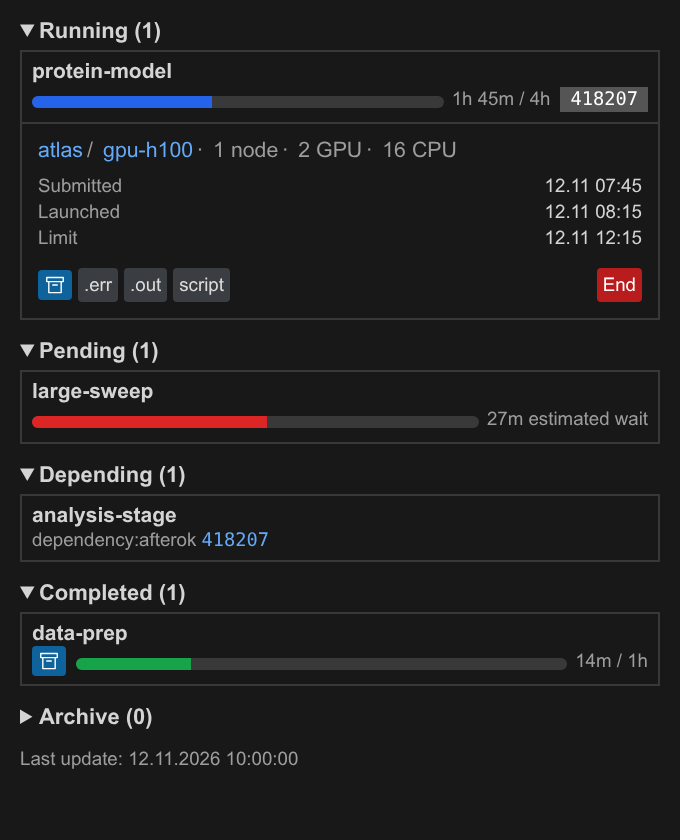
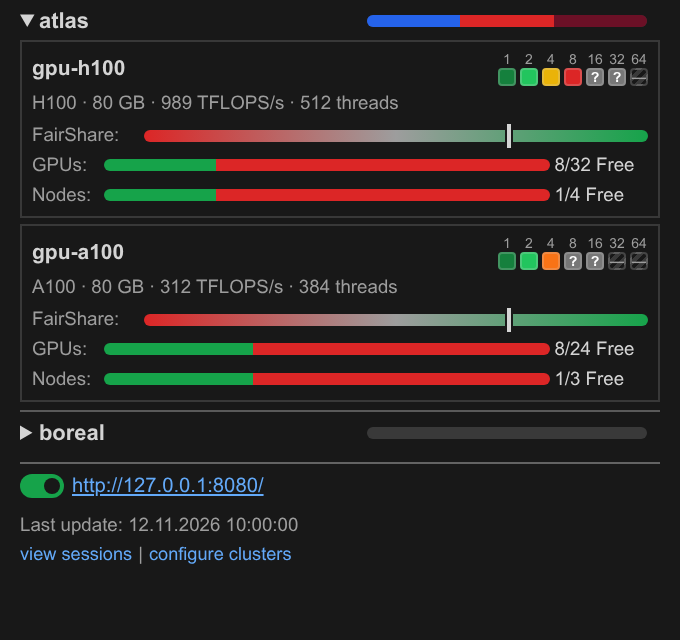
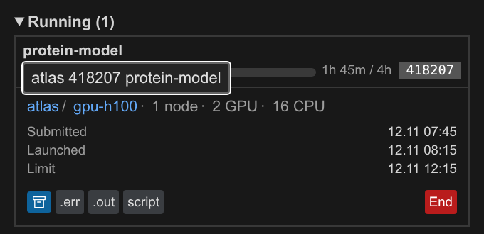
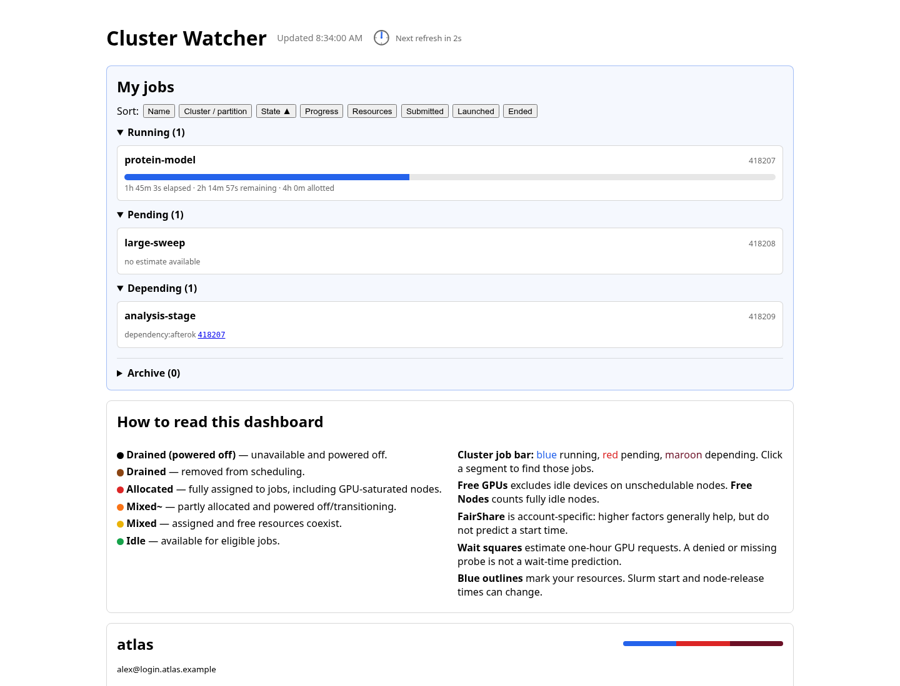
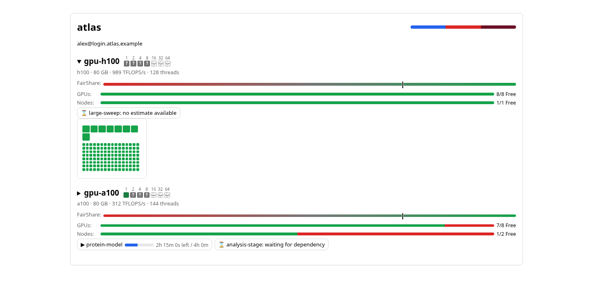
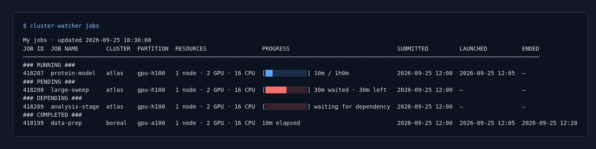
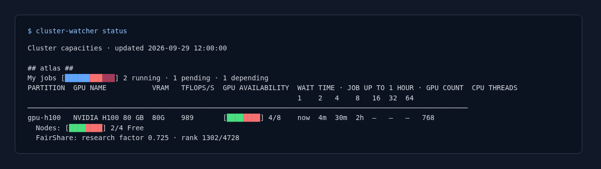

# Cluster Watcher

**See your Slurm jobs and find usable GPU capacity across several clusters without checking each one separately.**

When you work across multiple Slurm systems, the same questions recur: *Which jobs are running? Why is one still pending? Which partition has the GPUs I need? Will my account be able to use it?* Cluster Watcher brings the answers into a VS Code sidebar, a browser dashboard, and terminal boards. All three use your configured SSH connections; on systems with password and one-time-code login, reusable sessions avoid prompting on every refresh.

Cluster Watcher observes jobs and capacity. It does not submit jobs or choose a partition for you. Waits and start times are estimates from Slurm, not reservations.

<p align="center">
  
  &nbsp;&nbsp;
  
</p>
<p align="center"><sub>Current VS Code sidebar, rendered with example clusters and jobs.</sub></p>

## Get started

### 1. Install

On Linux or macOS, the installer downloads and checks a standalone executable. Python is not required:

```bash
curl -fsSL https://raw.githubusercontent.com/CameronBraunstein/cluster-watcher/master/install.sh | bash -s -- --add-to-path
```

Open a new terminal after installation. On Windows, use the [PowerShell installer](#other-install-options). The [release page](https://github.com/CameronBraunstein/cluster-watcher/releases) lists supported operating systems and architectures.

### 2. Describe your clusters

```bash
cluster-watcher setup
```

The wizard asks for each cluster's name, SSH host, and your username. It can also record GPU or APU profiles, login groups, and partition time limits. It writes **one** private `clusters.toml` file. To review or change it later, run `cluster-watcher config`.

A minimal entry looks like this:

```toml
[[machine]]
name = "atlas"
host = "login.atlas.example.org"
username = "alex"
```

Do not put passwords or one-time codes in the TOML file. Cluster Watcher uses SSH keys, your existing SSH setup, or interactive prompts. See [Authentication and shared sessions](#authentication-and-shared-sessions).

### 3. Choose a view

| View | Start it | Best for |
| --- | --- | --- |
| VS Code | Install the Cluster Watcher extension, open its Activity Bar view, and turn on the service. | Jobs, logs, partition cards, and SSH sessions alongside your code. |
| Browser | `cluster-watcher serve --jobs-api` | A larger dashboard with individual GPU and CPU blocks for each node. |
| Terminal | `cluster-watcher jobs` and `cluster-watcher status` | Fast readouts, including from an SSH terminal. |

The VS Code extension can install a matching backend on first use. A development checkout works with `python3 cluster_watcher.py <command>` or `python3 -m clusterwatcher <command>`.

## What you can see

### Your jobs

**My Jobs** separates Running, Pending, and Depending jobs. Pending jobs are eligible to wait in the scheduler; Depending jobs are held by a dependency. Failed dependencies, completed jobs, failures, and cancellations have their own sections. Active jobs are ordered by cluster, then newest submission time.

Running cards show elapsed time against the Slurm time limit. Pending cards show a start estimate when Slurm supplies one. Expand a card to see its partition, requested resources, submission and launch times, dependency, and priority information. In VS Code, cards can open their `.out` and `.err` files and submitted script; cancellation asks for confirmation. Archive hides a card from the main list and can be undone.

<p align="center"></p>

The browser has its own sortable, collapsible job cards and a browser-local archive. VS Code's archive is stored in VS Code state. These two archives do not synchronize.

### Cluster and partition status

Each cluster has a thin job bar: **blue** for Running, **red** for Pending, and **dark maroon** for Depending. Click a segment in VS Code or the browser to jump to those jobs for that cluster. Each partition then shows:

- GPU or APU model, per-device VRAM, FP16/BF16 Tensor throughput, and total CPU threads.
- A **FairShare** scale for each account association that can be mapped to that partition.
- **GPUs:** schedulable free devices out of the partition total, and **Nodes:** fully idle nodes out of the total.
- Wait estimates for one-hour jobs requesting 1, 2, 4, 8, 16, 32, or 64 GPUs, when the site permits a probe. The configured partition wall-time cap applies to development partitions.

Green availability and completion indicators in the VS Code sidebar use the same shade shown in the screenshots.

The browser preserves the node-level view below each compact partition summary. Expand a partition to see one box per node, with large GPU blocks above small CPU blocks. Blue outlines mark resources used by your jobs. A partition or cluster may be reachable while a particular wait probe is denied; the interface labels that result rather than turning it into a fake wait time.

<p align="center"></p>
<p align="center"><sub>Browser overview with example data.</sub></p>

<p align="center"></p>
<p align="center"><sub>Expanded browser cluster and partition. The node boxes remain available beneath the compact summaries.</sub></p>

### What the numbers mean

| Signal | Interpretation |
| --- | --- |
| Free GPUs | Devices reported idle **and schedulable**. An idle GPU on a drained or reserved node does not count as free. |
| Free Nodes | Nodes reported fully idle on a usable partition. A mixed node may still have free GPUs. |
| FairShare | A factor from 0 to 1 for a mapped account association. Higher factors generally help; a lower displayed rank number is better among visible associations. Your job uses its submitted account, which may differ from another bar shown. |
| Pending priority | A relative queue rank, not a probability of starting soon. QOS, reservations, age, backfill, and resource fit also matter. |
| Wait estimate | Slurm's current prediction or test-only result for a specified request. It can change and does not guarantee a start time. |
| GPU hours | GPU count multiplied by remaining time for Running jobs, or requested time limit for Pending and Depending jobs. It is an upper-limit resource measure. |

Free capacity is only one part of scheduling. A job can remain pending even when some devices are green because its node count, memory, account, QOS, or requested wall time cannot fit the available shape. [The detailed reference](REFERENCE.md#reading-the-numbers) explains the estimates and failure labels.

## Use it from the terminal

```bash
cluster-watcher jobs             # recent personal jobs, once
cluster-watcher jobs 15          # refresh every 15 seconds
cluster-watcher status           # capacity, fair share, and wait probes
cluster-watcher status 15        # live capacity board
cluster-watcher status atlas     # one configured cluster
cluster-watcher sessions         # reusable SSH-session state
```

The live boards use the terminal's alternate screen: old frames are replaced, scroll keys navigate the board, and `q` exits. Redirected output stays plain. `jobs` groups active jobs by cluster and submission time; `status` shows one table per cluster, followed by free-node and mapped fair-share lines for each partition.

<p align="center"></p>
<p align="center"><sub>Personal jobs board, with example data.</sub></p>

<p align="center"></p>
<p align="center"><sub>Capacity board, with example data.</sub></p>

Run `cluster-watcher jobs -h` or `cluster-watcher status -h` for selection, timeout, JSON, and refresh options. Terminal `status` gathers personal job and fair-share information as well as physical capacity, so its first collection can take longer than a capacity-only SSH command. The browser and extension keep a running service and refresh in the background.

## Configure and authenticate

The installer and extension use a per-user config directory: `~/.config/cluster-watcher/clusters.toml` on a typical Linux desktop, the application-support directory on macOS, or `%APPDATA%\ClusterWatcher\clusters.toml` on Windows. A source checkout uses a local `clusters.toml` by default. `--config PATH` overrides either choice. Use `cluster-watcher config` to open the file actually selected.

For password plus one-time-code clusters, mark the machine for interactive authentication in the wizard or TOML:

```toml
[[machine]]
name = "atlas"
host = "login.atlas.example.org"
username = "alex"
interactive_auth = true
credential_group = "research-centre"
control_persist = "8h"
```

`cluster-watcher login` opens reusable SSH control sessions; `cluster-watcher sessions` shows their state. The VS Code sidebar offers per-cluster login controls and a group login when credentials are shared. The extension's service runs in tmux, so closing one VS Code window does not stop it. Sessions survive while their SSH masters remain alive; a machine reboot or expired site authentication still requires a new login. VS Code Remote SSH runs the extension and backend on the remote development host, so laptop and remote-host sessions are separate.

Multiple login nodes, optional identity files, GPU/APU profiles, time limits, wait thresholds, and log roots are documented in [Configuration](REFERENCE.md#configure). The setup wizard validates the file and retains a backup when replacing one.

## Other install options

| Platform or use | Method |
| --- | --- |
| Windows | Download and run [`install.ps1`](install.ps1) with `-AddToPath`. Password/OTP session reuse needs WSL because Windows OpenSSH does not provide the required connection sharing. |
| Python 3.11+ | `pipx install git+https://github.com/CameronBraunstein/cluster-watcher` |
| Editable development checkout | `python3 -m pip install --editable .` |
| Build a native executable locally | `./install.sh --from-source --add-to-path` |
| Remove the installed command | `./uninstall.sh` (or `uninstall.ps1` on Windows). Configuration is preserved unless you request its removal. |

The extension and standalone command can coexist. On the same host, as the same local user, and with matching cluster settings, they recognize the same OpenSSH control sessions. Details on binary naming, checksums, PATH changes, custom destinations, and uninstall behavior are in [the installation reference](REFERENCE.md#install).

## Scripts and agents

The local service provides versioned JSON endpoints for cluster snapshots, personal jobs, session state, logs, and submitted scripts:

```bash
curl --fail --silent http://127.0.0.1:8080/api/v1/snapshot?detail=summary
curl --fail --silent http://127.0.0.1:8080/api/v1/jobs
```

Start the service with `--jobs-api` for personal jobs. Cancellation is a separate action; remote command execution needs the separate `--command-api` opt-in. The service binds to loopback by default and has no built-in authentication or TLS. Keep personal APIs on loopback; use an SSH tunnel to view the dashboard from another machine.

See [API schemas and examples](REFERENCE.md#apis-for-scripts-and-agents) and the copy-ready [agent capabilities guide](AGENT_CAPABILITIES.md).

## Develop and contribute

```bash
python3 -m unittest discover -s tests -q
cd vscode && npm test
```

Tests use simulated clusters and do not need your private config or active SSH sessions. For the VS Code integration suite, run `npm run test:integration` from `vscode/` (headless Linux needs `xvfb-run -a`). The repository's [reference](REFERENCE.md#development) covers the module layout, source extension launch, packaging, and release workflow.

The [original project icon](vscode/media/LICENSE.txt) is CC0-1.0. Cluster Watcher itself is licensed under [GPL-3.0-or-later](LICENSE).
