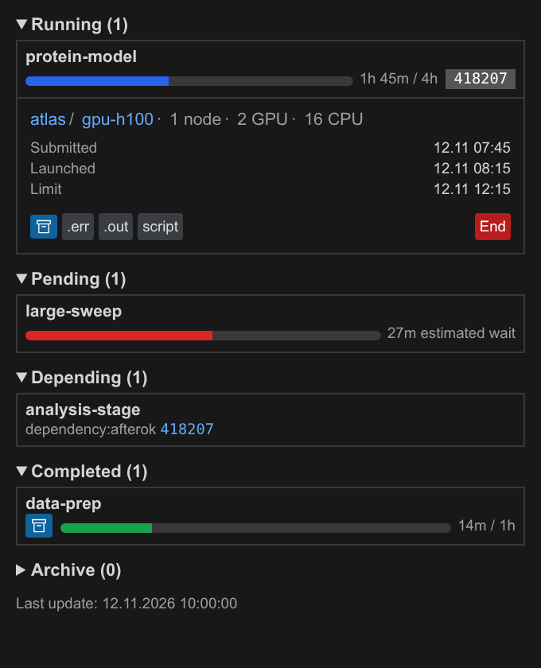
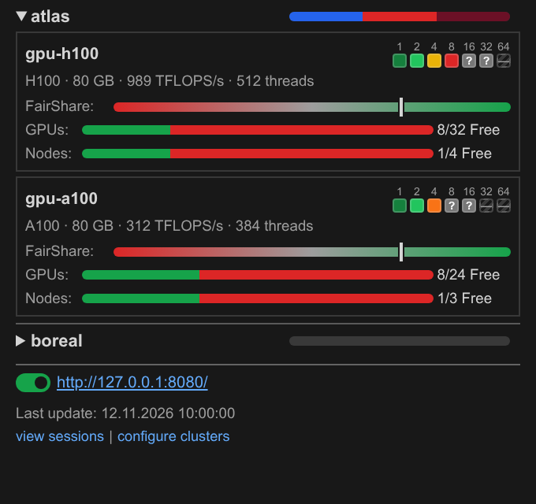
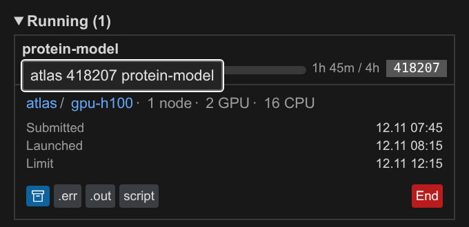
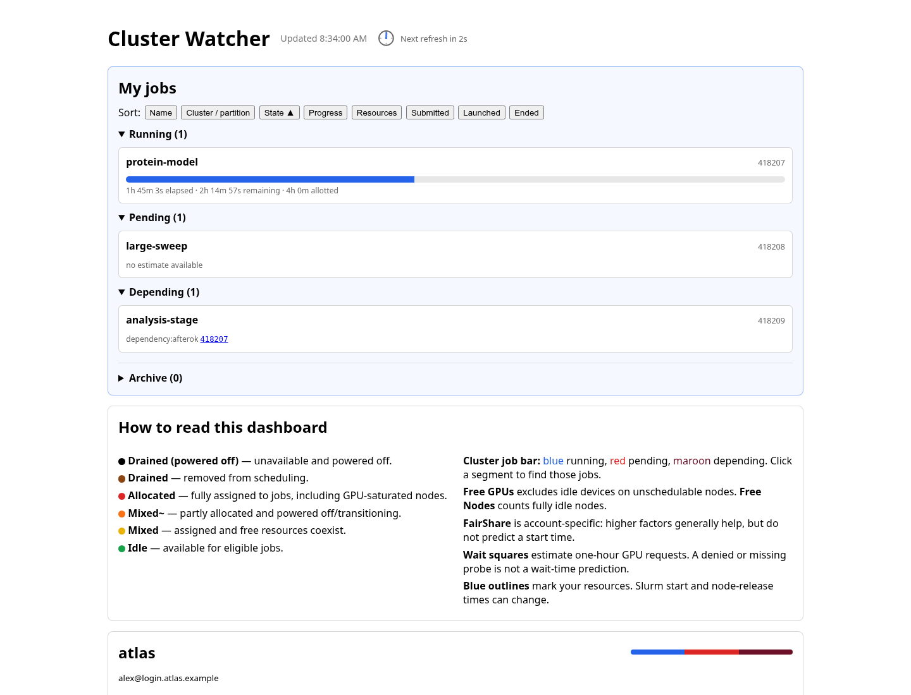
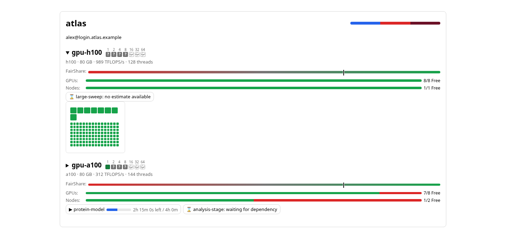
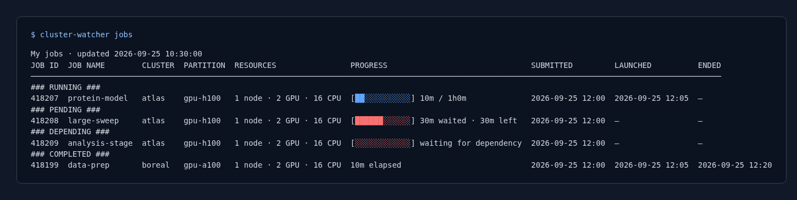
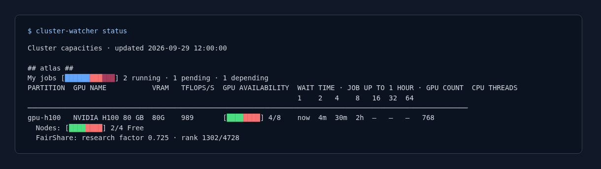

# Cluster Watcher

**See your Slurm and HTCondor jobs and find usable GPU capacity across several clusters without checking each one separately.**

When you work across multiple clusters, the same questions recur: *Which jobs are running? Why is one still pending? Which machines have free GPUs?* Cluster Watcher brings the answers into a VS Code sidebar, a browser dashboard, and terminal boards. All three use your configured SSH connections; on systems with password and one-time-code login, reusable sessions avoid prompting on every refresh.

Cluster Watcher observes jobs and capacity. It does not submit jobs or choose a partition for you. Slurm waits and start times are estimates, not reservations. HTCondor does not provide an equivalent generic start-time prediction for hypothetical jobs.

<p align="center">
  
  &nbsp;&nbsp;
  
</p>
<p align="center"><sub>Current VS Code sidebar, rendered with example clusters and jobs.</sub></p>

## Get started

### 1. Install

On Linux or macOS, the installer downloads and checks a standalone executable. Python is not required:

```bash
curl -fsSL https://raw.githubusercontent.com/CameronBraunstein/cluster-watcher/master/install.sh | bash -s -- --add-to-path
```

Open a new terminal after installation. On Windows, use the [PowerShell installer](#other-install-options). The [release page](https://github.com/CameronBraunstein/cluster-watcher/releases) lists supported operating systems and architectures.

### 2. Describe your clusters

```bash
cluster-watcher setup
```

The wizard asks for each cluster's name, SSH host, username, and scheduler. It can also record GPU or APU profiles, login groups, and Slurm partition time limits. It writes **one** private `clusters.toml` file. To review or change it later, run `cluster-watcher config`. The wizard validates configuration; it does not check or install `tmux`, which the VS Code extension needs to start a persistent service.

A minimal entry looks like this:

```toml
[[machine]]
name = "atlas"
host = "login.atlas.example.org"
username = "alex"
# scheduler = "auto"  # Or "slurm" / "condor".
```

Do not put passwords or one-time codes in the TOML file. Cluster Watcher uses SSH keys, your existing SSH setup, or interactive prompts. See [Authentication and shared sessions](#authentication-and-shared-sessions).

### 3. Choose a view

| View | Start it | Best for |
| --- | --- | --- |
| VS Code | Install the Cluster Watcher extension, open its Activity Bar view, and turn on the service. | Jobs, logs, partition cards, and SSH sessions alongside your code. |
| Browser | `cluster-watcher serve --jobs-api` | A larger dashboard with individual GPU and CPU blocks for each node. |
| Terminal | `cluster-watcher jobs` and `cluster-watcher status` | Fast readouts, including from an SSH terminal. |

The VS Code extension can install a matching backend on first use. A development checkout works with `python3 cluster_watcher.py <command>` or `python3 -m clusterwatcher <command>`.

**Before starting the service from VS Code, install `tmux` on the machine running the extension.** With Remote SSH, this is the remote development host; with WSL, it is the WSL distribution. The backend installer does not install `tmux`.

```bash
# Ubuntu / Debian, on the extension host:
sudo apt-get update
sudo apt-get install tmux
tmux -V
```

On macOS with Homebrew, use `brew install tmux`. Then select **Cluster Watcher: Start Service & SSH Sessions** in VS Code. If you see **tmux is required**, follow the [extension troubleshooting steps](vscode/README.md#tmux-is-required). Running `cluster-watcher serve --jobs-api` directly in a terminal does not require `tmux`; keep that terminal open while using the service.

## What you can see

### Your jobs

**My Jobs** separates Running, Pending, Depending, and Held Jobs. Pending jobs are eligible to wait in the scheduler; Depending jobs await a dependency. Held Jobs contains jobs held by the user, an administrator, or a system policy, between Depending and Completed. Held cards show the scheduler's reason when available and do not show a start estimate. Failed dependencies, completed jobs, failures, and cancellations have their own sections. Active jobs are ordered by cluster, then newest submission time.

In an expanded dependency row, **⏳** means a prerequisite is still outstanding, **✓** means satisfied, and a plain red **✕** means it cannot be satisfied. The icon hover explains the referenced job. An empty cluster job bar says **No jobs running nor queued** on hover.

Running cards show elapsed time against a time limit when the scheduler supplies one. Pending cards show a start estimate when Slurm supplies one. Expand a card to see its partition or Condor pool, requested resources, submission and launch times, and available scheduler details. In VS Code, cards can open their `.out` and `.err` files; Slurm cards can also open a submitted script when recoverable. Cancellation asks for confirmation. Archive hides a card from the main list and can be undone.

If a cluster disconnects, My Jobs keeps its last known cards and places a yellow ⚠ beside jobs from that cluster. Hover over it for the connection error and latest successful update. Other clusters continue to refresh. If the local jobs API itself becomes unreachable, all previously loaded cards remain visible with warnings. These cards show **last known state** and frozen progress, which may have changed; VS Code hides the End action until the cluster reconnects. Warnings clear when fresh data arrives. Before the first successful load, there are no previous cards to retain.

<p align="center"></p>

The browser has its own sortable, collapsible job cards and a browser-local archive. VS Code's archive is stored in VS Code state. These two archives do not synchronize.

### Cluster and partition status

Each cluster has a thin job bar, ordered left to right: **light gray** for Failed Dependency, **yellow** for Held Jobs, **dark maroon** for Depending, **red** for Pending, and **blue** for Running. Held jobs do not contribute to the runnable pending or depending segments. The gray segment counts jobs whose dependencies Slurm reports as impossible. Click any segment in VS Code or the browser to jump to that cluster's jobs in the corresponding group. Slurm partitions and HTCondor's GPU-model display groups then show:

In the VS Code Cluster Status view, short cluster names remain visible even at the sidebar's minimum width; the job bars shrink to make room. Hover over a clipped name to see it in full. The bars stay aligned when a warning appears. A yellow ⚠ marks a communication or refresh failure that began within the last three minutes; a red **!** means the failure has lasted longer. Hover over either icon for the error and the latest successful update. The last known cluster cards remain visible while the service retries. Once the cluster refreshes successfully, the warning clears.

- GPU or APU model, per-device VRAM, FP16/BF16 Tensor throughput, and total CPU threads.
- Slurm **FairShare** for mapped account associations, or HTCondor **pool share** and effective user priority when the negotiator reports them.
- **GPUs:** schedulable free devices out of the partition total, and **Nodes:** fully idle nodes out of the total.
- Slurm wait estimates for one-hour jobs requesting 1, 2, 4, 8, 16, 32, or 64 GPUs, when the site permits a probe. The configured partition wall-time cap applies to development partitions. HTCondor shows **FREE** when one host advertises enough free GPUs, **BUSY** when that GPU count fits a host but none is currently free, and **MULTI** when no single host has enough GPUs. These are capacity observations, not start-time estimates; matchmaking, access rules, and other users still apply.

GPU and node availability bars show unavailable capacity in red on the left and free capacity in green on the right. Running-job progress uses blue independently of the VS Code theme.

The browser preserves the node-level view below each compact partition summary. Expand a partition to see one box per node, with large GPU blocks above small CPU blocks. Blue outlines mark resources used by your jobs. A partition or cluster may be reachable while a particular wait probe is denied; the interface labels that result rather than turning it into a fake wait time.

<p align="center"></p>
<p align="center"><sub>Browser overview with example data.</sub></p>

<p align="center"></p>
<p align="center"><sub>Expanded browser cluster and partition. The node boxes remain available beneath the compact summaries.</sub></p>

### What the numbers mean

| Signal | Interpretation |
| --- | --- |
| Free GPUs | Devices reported idle **and schedulable**. For HTCondor, free GPUs are the resources advertised by partitionable or unclaimed static slots; dynamic slots account for assigned GPUs. |
| Free Nodes | Nodes reported fully idle on a usable partition. A mixed node may still have free GPUs. |
| FairShare | Slurm: a factor from 0 to 1 for a mapped account association. Higher factors generally help; a lower displayed rank number is better among visible associations. |
| Pool share | HTCondor: the negotiator's estimated share for your submitter, assuming jobs can match the pool. Lower **effective priority** values get precedence. This is different from a Slurm FairShare factor. |
| Pending priority | A relative queue rank, not a probability of starting soon. QOS, reservations, age, backfill, and resource fit also matter. |
| Wait estimate | Slurm's current prediction or test-only result for a specified request. It can change and does not guarantee a start time. HTCondor instead reports current single-host fit as FREE, BUSY, or MULTI. |
| GPU hours | GPU count multiplied by remaining time for Running jobs, or requested time limit for Pending and Depending jobs. It is an upper-limit resource measure. |

Free capacity is only one part of scheduling. A job can remain pending even when some devices are green because its node count, memory, account, QOS, or requested wall time cannot fit the available shape. [The detailed reference](REFERENCE.md#reading-the-numbers) explains the estimates and failure labels.

## Use it from the terminal

```bash
cluster-watcher jobs             # recent personal jobs, once
cluster-watcher jobs 15          # refresh every 15 seconds
cluster-watcher status           # capacity, fair share, and wait probes
cluster-watcher status 15        # live capacity board
cluster-watcher status atlas     # one configured cluster
cluster-watcher sessions         # reusable SSH-session state
```

The live boards use the terminal's alternate screen: old frames are replaced, scroll keys navigate the board, and `q` exits. Redirected output stays plain. `jobs` groups active jobs by cluster and submission time; `status` shows one table per cluster, followed by free-node and mapped fair-share lines for each partition.

<p align="center"></p>
<p align="center"><sub>Personal jobs board, with example data.</sub></p>

<p align="center"></p>
<p align="center"><sub>Capacity board, with example data.</sub></p>

Run `cluster-watcher jobs -h` or `cluster-watcher status -h` for selection, timeout, JSON, and refresh options. Terminal `status` gathers personal job and fair-share information as well as physical capacity, so its first collection can take longer than a capacity-only SSH command. The browser and extension keep a running service and refresh in the background.

### Run a script on an SSH host without a scheduler

Use a `direct` cluster for machines with SSH and tmux but no Slurm or HTCondor. Each value in `host` is an independent machine, not a failover login address. The same username, port, and SSH identity apply to each host. Configure SSH keys or an agent for noninteractive login; `interactive_auth` is not supported for direct members.

```toml
[[machine]]
name = "lab"
scheduler = "direct"
host = ["gpu-a.example.org", "gpu-b.example.org"]
username = "alex"
```

Put the script in a directory that already exists on the selected remote host, then run:

```bash
cluster-watcher submit lab gpu-a.example.org /home/alex/experiments train.sh
```

The script runs once in a detached remote tmux session named `cw-<job-id>`. Cluster Watcher prints the numeric job ID, session name, and log paths. It records the job on that host, so `cluster-watcher jobs`, the browser, and VS Code My Jobs can show its running or finished state after the submit command exits. Cluster Status lists each direct host and its running job count. GPU availability, wait times, and free CPU capacity are **unknown** because there is no scheduler or reservation system. CPU/GPU counts parsed from the script are descriptive requests only; they do not reserve or limit hardware. Direct jobs currently cannot be ended from the dashboard.

The script may use Slurm-style `#SBATCH` header lines for `--job-name`, `--output`, and `--error`; `-J`, `-o`, and `-e` are accepted too. Relative log paths are resolved under the supplied remote directory. `%j` expands to Cluster Watcher's job ID, `%x` to the job name, `%N` to the chosen host's short name, `%u` to the configured username, and `%%` to a literal percent sign. Without `--output`, output and errors share `slurm-%j.out`, following [Slurm's default](https://slurm.schedmd.com/sbatch.html). Cluster Watcher opens the recorded `.out` and `.err` files from the original host; it does not upload the script. `--cpus-per-task`, `--ntasks`, `--gpus`, and `--gres=gpu:...` are read for display only. Other allocation directives, including `--time`, are not enforced. `--nodes` must be 1, and arrays and dependencies are rejected. The script is run with Bash, so commands that require `srun` or another Slurm service will need to be adapted.

## Configure and authenticate

The installer and extension use a per-user config directory: `~/.config/cluster-watcher/clusters.toml` on a typical Linux desktop, the application-support directory on macOS, or `%APPDATA%\ClusterWatcher\clusters.toml` on Windows. A source checkout uses a local `clusters.toml` by default. `--config PATH` overrides either choice. Use `cluster-watcher config` to open the file actually selected.

For password plus one-time-code clusters, mark the machine for interactive authentication in the wizard or TOML:

```toml
[[machine]]
name = "atlas"
host = "login.atlas.example.org"
username = "alex"
interactive_auth = true
credential_group = "research-centre"
control_persist = "8h"
```

`cluster-watcher login` opens reusable SSH control sessions; `cluster-watcher sessions` shows their state. The VS Code sidebar offers per-cluster login controls and a group login when credentials are shared. The extension's service runs in tmux, so closing one VS Code window does not stop it. Sessions survive while their SSH masters remain alive; a machine reboot or expired site authentication still requires a new login. VS Code Remote SSH runs the extension and backend on the remote development host, so laptop and remote-host sessions are separate.

Use **Log in** or `cluster-watcher login CLUSTER --only` for first-time setup, including password-only and key/agent clusters with no `interactive_auth` setting. Explicit login requests passwords, OTPs, or key passphrases only when SSH asks for them. A first-time connection shows **Trust this SSH host?** with OpenSSH's hostname and fingerprint; compare it with your administrator's published value before choosing **Trust Host**. OpenSSH saves the login host's key on the extension host. For a configured `submission_host`, login then checks that hop over the same connection and can request separate approval; its key is saved on the login node. Cancelling declines that connection, and an already-open login session is reused on retry. Terminal login supports the same confirmations. Existing SSH policies apply: changed keys need investigation, and `StrictHostKeyChecking=yes` requires keys to be provisioned beforehand.

The sidebar checks the lightweight `/api/v1/service` endpoint to see whether that local process is running. A single slow check shows **Service check timed out; retrying…** while keeping the current views; the third consecutive timeout marks it offline. A definite connection refusal marks it offline immediately. The SSH session inventory can also confirm that the service is reachable when the identity check is slow. A timed-out cluster snapshot keeps the last Cluster Status visible with a warning; before the first snapshot, it stays on Loading and retries. This prevents a busy host from briefly collapsing My Jobs and Cluster Status. If the sidebar reports repeated timeouts, compare `curl --max-time 10 http://127.0.0.1:8080/api/v1/service` with your configured `clusterWatcher.backendUrl` and check whether the host or tmux service is overloaded.

If scheduler commands run on a submission host behind the login node, set `submission_host` on that machine. Cluster Watcher authenticates to `host` once, then SSHes from there to `submission_host` for status, jobs, logs, commands, and shells:

```toml
[[machine]]
name = "atlas"
host = "login.atlas.example.org"
username = "alex"
interactive_auth = true
submission_host = "submit.atlas.internal"
```

The second hop must work without another password or OTP. `cluster-watcher login atlas --only` checks the hop and offers first-time host-key approval using the login node's SSH configuration. Routine polling stays noninteractive. The session view shows the login-to-submission route. See [Two-hop SSH](REFERENCE.md#two-hop-ssh-to-a-submission-host) for details.

### HTCondor machines

For a Condor submit host, use the same `[[machine]]` entry and select `scheduler = "condor"`; `scheduler = "auto"` is the default. Auto detection checks for `sinfo` and `condor_q` on the final submission host once per process. If both are installed, set the scheduler explicitly. If neither is present, check the SSH route and remote `PATH`.

```toml
[[machine]]
name = "lst"
host = "login.lst.uni-saarland.de"
username = "cameronb"
submission_host = "your-submit-host" # Omit when `host` already runs Condor commands.
scheduler = "condor"
```

HTCondor has slots rather than Slurm partitions. The dashboard shows **pool: H200**, **pool: H100**, and other GPU-model groups based on each host's advertised model. **pool** remains an aggregate of all hosts; do not add its counts to the model groups. These names are display groups, not submit targets. Hosts with unknown or mixed GPU models remain only in pool. It reads live jobs with `condor_q -json`, recent completed jobs with `condor_history -json`, capacity and GPU names with `condor_status -json`, and pool-wide submitter priority with `condor_userprio`. An empty queue is normal. `ClusterId.ProcId` keeps individual jobs in one submit cluster distinct. Add a `[[profile]]` with the reported model as an alias to display TFLOPS/s. HTCondor user priority is **lower is better**; pool share is an estimate from the negotiator, not a GPU-model-specific entitlement.

Condor `.out` and `.err` files are read from the submit host when a job ad contains their paths. A running job may not have created a file yet, and file transfer or site policy may delay its appearance. The first read needs an SSH round trip; recent job history and resolved paths are cached to avoid repeating slow `condor_history` lookups on each click. When a job advertises `JobSubmitFile`, its card offers **script** to open the current `.sub` file. Condor does not retain an immutable copy here, so this file may have changed since submission or may no longer exist. Held Condor jobs appear in Held Jobs, with their `HoldReason` visible when reported. Slurm jobs enter Held Jobs when their state is `REQUEUE_HOLD` or `RESV_DEL_HOLD`, or their reason begins with `JobHeld` or `JobHold`.

The `lst` configuration now includes these five models. Values are **per GPU**; the node table's memory column summed eight devices. The throughput column uses dense FP16/BF16 Tensor performance, excluding the vendor's sparsity multiplier.

| LST GPU | VRAM | Dense Tensor TFLOPS/s |
| --- | ---: | ---: |
| H200 NVL | 141 GB | 835.5 |
| H100 PCIe | 80 GB | 756 |
| A100 PCIe 80 GB | 80 GB | 312 |
| A100 PCIe 40 GB | 40 GB | 312 |
| V100 PCIe 32 GB | 32 GB | 112 |

Sources: [H200 NVL datasheet](https://www.nvidia.com/en-in/data-center/h200/), [H100 PCIe whitepaper](https://resources.nvidia.com/en-us-hopper-architecture), [A100 datasheet](https://www.nvidia.com/content/dam/en-zz/Solutions/Data-Center/a100/pdf/nvidia-a100-datasheet-us-nvidia-1758950-r4-web.pdf), [V100 PCIe datasheet](https://images.nvidia.com/content/technologies/volta/pdf/tesla-volta-v100-datasheet-letter-fnl-web.pdf). H200's published BF16 value includes sparsity, so the dense value is half of 1,671 TFLOPS/s.

Multiple login nodes, optional identity files, GPU/APU profiles, time limits, wait thresholds, and log roots are documented in [Configuration](REFERENCE.md#configure). The setup wizard validates the file and retains a backup when replacing one.

## Other install options

| Platform or use | Method |
| --- | --- |
| Windows | Download and run [`install.ps1`](install.ps1) with `-AddToPath`. Password/OTP session reuse needs WSL because Windows OpenSSH does not provide the required connection sharing. |
| Python 3.11+ | `pipx install git+https://github.com/CameronBraunstein/cluster-watcher` |
| Editable development checkout | `python3 -m pip install --editable .` |
| Build a native executable locally | `./install.sh --from-source --add-to-path` |
| Remove the installed command | `./uninstall.sh` (or `uninstall.ps1` on Windows). Configuration is preserved unless you request its removal. |

The extension and standalone command can coexist. On the same host, as the same local user, and with matching cluster settings, they recognize the same OpenSSH control sessions. Details on binary naming, checksums, PATH changes, custom destinations, and uninstall behavior are in [the installation reference](REFERENCE.md#install).

## Scripts and agents

The local service provides versioned JSON endpoints for cluster snapshots, personal jobs, session state, logs, and submitted scripts:

```bash
curl --fail --silent http://127.0.0.1:8080/api/v1/snapshot?detail=summary
curl --fail --silent http://127.0.0.1:8080/api/v1/jobs
```

Start the service with `--jobs-api` for personal jobs. Cancellation is a separate action; remote command execution needs the separate `--command-api` opt-in. The service binds to loopback by default and has no built-in authentication or TLS. Keep personal APIs on loopback; use an SSH tunnel to view the dashboard from another machine.

See [API schemas and examples](REFERENCE.md#apis-for-scripts-and-agents) and the copy-ready [agent capabilities guide](AGENT_CAPABILITIES.md).

## Develop and contribute

```bash
python3 -m unittest discover -s tests -q
cd vscode && npm test
```

Tests use simulated clusters and do not need your private config or active SSH sessions. For the VS Code integration suite, run `npm run test:integration` from `vscode/` (headless Linux needs `xvfb-run -a`). The repository's [reference](REFERENCE.md#development) covers the module layout, source extension launch, packaging, and release workflow.

The [original project icon](vscode/media/LICENSE.txt) is CC0-1.0. Cluster Watcher itself is licensed under [GPL-3.0-or-later](LICENSE).
